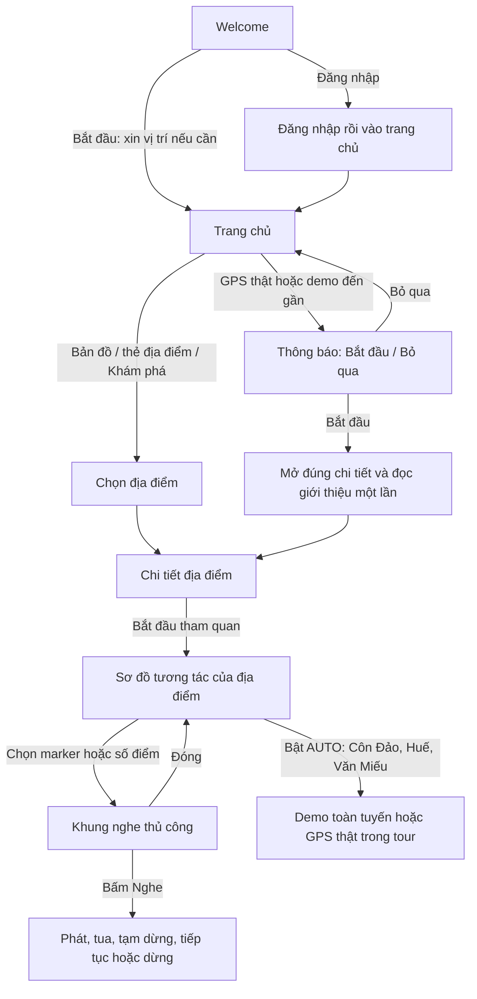
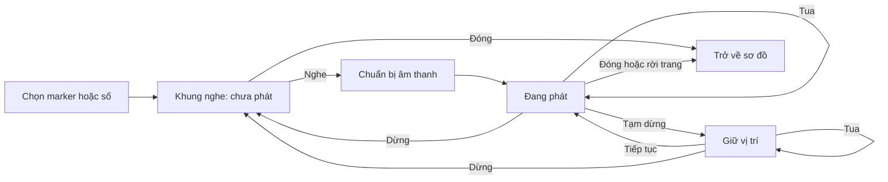
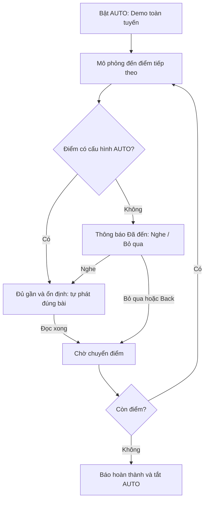

# APP_CK – Ứng dụng hỗ trợ tham quan du lịch

Ứng dụng Android hỗ trợ tra cứu điểm du lịch, xem bản đồ và sơ đồ tương tác, nghe thuyết minh tiếng Việt, lưu yêu thích và quản lý hồ sơ cá nhân.

**Cập nhật ngày 25/10/2026 theo mã nguồn trong workspace, bao gồm các thay đổi chưa commit.** Hiện có **5 địa điểm, 83 điểm tham quan thành phần, 82 marker trên sơ đồ, 17 Activity và SQLite v12**. Dữ liệu tài khoản và nội dung được lưu cục bộ; chưa có backend, lịch sử tham quan hoặc quản trị.

README mô tả mã nguồn hiện tại. Phần đối chiếu **`Nhom15_BaoCao.docx`** giữ căn cứ đã ghi nhận từ các lần rà soát trước; tệp Word không nằm trong repository và chưa được đọc lại trong đợt cập nhật này. Trạng thái “có luồng chính” bên dưới không đồng nghĩa đã hoàn thành toàn bộ đặc tả hoặc đã kiểm chứng thực địa.

**Mốc tiến độ tổng thể đã ước lượng trước đây: khoảng 60% so với toàn bộ yêu cầu trong báo cáo Word**, tính cả quản trị và phân quyền. Đây là ước lượng theo mức độ hiện thực chức năng, chưa phải tỷ lệ nghiệm thu chính thức hoặc tỷ lệ được chấm lại trong đợt cập nhật README này. Căn cứ và phần còn thiếu được trình bày tại mục 13; các bước hoàn thiện ở mục 15.

**Đọc nhanh luồng chính:**

- [Bản đồ địa điểm và đường vào sơ đồ](#6-ban-do-dia-diem-va-trang-chi-tiet).
- [Sơ đồ tương tác, tầng và marker](#7-so-do-tuong-tac-va-du-lieu-thuyet-minh).
- [Thuyết minh thủ công, GPS thật và demo](#8-luong-chinh-tu-ban-do-den-thuyet-minh).
- [Quyền vị trí, đóng khung và rời màn hình](#14-quyen-vi-tri-vong-doi-va-xu-ly-ngoai-le).
- [Phần còn thiếu và các bước hoàn thiện](#15-cac-buoc-tiep-theo-de-hoan-thanh-luong-chinh).
- [Lỗi và hạn chế ghi nhận khi rà soát](#18-loi-va-han-che-hien-tai).
- [Bằng chứng kiểm thử và giới hạn xác nhận](#19-trang-thai-kiem-thu).
- [Bộ nội dung và nguồn thông tin chính thức](#20-noi-dung-va-nguon-thong-tin).

## 1. Tổng quan và phạm vi

| Nội dung | Hiện trạng |
| --- | --- |
| Tên / phiên bản | APP_CK / `1.0`, versionCode `1` |
| Namespace / applicationId | `com.example.app_ck` |
| Giao diện | Android Java, XML, một số sơ đồ và thẻ dựng bằng Java/Canvas |
| Dữ liệu | SQLite trên thiết bị; sơ đồ khởi tạo từ Java, bài giới thiệu từ các lớp Java ngoại tuyến có nguồn |
| Bản đồ | OpenStreetMap qua osmdroid; chỉ đường bằng URL Google Maps |
| Giọng đọc | TTS tiếng Việt; khung nghe thủ công tổng hợp ra tệp tạm rồi phát bằng MediaPlayer để tua/tạm dừng |
| Chế độ tham quan | Welcome → xin vị trí tại trang chủ; GPS/demo nhận diện điểm chính trong 100 m, hỏi Bắt đầu/Bỏ qua; Côn Đảo, Đại Nội Huế và Văn Miếu có thêm AUTO chọn lọc; Dinh/Bảo tàng nghe thủ công |
| Tài khoản | Đăng ký, đăng nhập, mã khôi phục, hồ sơ, đổi mật khẩu, đăng xuất |
| Cá nhân hóa | Yêu thích theo tài khoản; gợi ý theo danh mục của các điểm đã lưu |

Ứng dụng cho phép khách khám phá mà chưa đăng nhập. Danh sách yêu thích và thao tác thay đổi hồ sơ yêu cầu đăng nhập. Dữ liệu chưa đồng bộ giữa các thiết bị.

**Kiến trúc:** một module Android `app`, gồm 17 Activity khai báo trong manifest. Activity trực tiếp xử lý phần lớn giao diện, truy vấn SQLite và điều khiển TTS; chưa tách lớp Repository/ViewModel. `BaseActivity` dùng chung cho khoảng đệm hệ thống và khung nghe; `ThanhDieuHuongDuoi` điều hướng các tab. Các bộ nhận diện vị trí, điều phối AUTO và trình nghe được tách thành lớp riêng. `KhamPhaActivity` phục vụ cả tab Khám phá và Gợi ý.

**Tên file hiện hành:** giữ các tên Java như `MainActivity.java`, `WelcomeActivity.java`, `BaoTangThamQuanActivity.java`, `TaiKhoanDb.java` và các layout `activity_…`, `view_…`, `sheet_…`, `item_…` theo cây mã nguồn ở mục 17. Package vẫn là `com.example.app_ck`.

## 2. Công nghệ và cấu hình

| Thành phần | Cấu hình trong dự án |
| --- | --- |
| Android SDK | minSdk `24`, targetSdk `36`, compileSdk `36.1` |
| Mã nguồn Java | sourceCompatibility và targetCompatibility `11` |
| Gradle / Android Gradle Plugin | `9.3.1` / `9.1.1` |
| AndroidX | AppCompat `1.8.0`, Activity `1.13.0`, ConstraintLayout `2.2.2` |
| Material Components | `1.14.0` |
| osmdroid | `6.1.20` |
| Kiểm thử | JUnit `4.13.2`, AndroidX JUnit `1.3.0`, Espresso `3.7.0` |

Cấu hình nằm tại [app/build.gradle.kts](app/build.gradle.kts), [libs.versions.toml](gradle/libs.versions.toml) và [Gradle Wrapper](gradle/wrapper/gradle-wrapper.properties). Mức Java 11 của mã nguồn khác với JDK chạy Gradle; môi trường build đã dùng JDK 21.

## 3. Mở dự án và chạy ứng dụng

1. Mở thư mục gốc bằng Android Studio; dùng JDK 21 cho Gradle.
2. Cài Android SDK tương ứng `compileSdk 36.1`, Platform Tools và đồng bộ Gradle.
3. Khai báo SDK trong `local.properties` theo máy đang dùng; không đưa đường dẫn riêng của máy vào repository.
4. Chạy module `app` trên thiết bị/emulator Android 7.0 trở lên.
5. Cài hoặc bật giọng đọc **Tiếng Việt** trong phần Text-to-speech của thiết bị để nghe thuyết minh.

Lệnh PowerShell tại thư mục gốc:

```powershell
.\gradlew.bat :app:assembleDebug
.\gradlew.bat :app:testDebugUnitTest :app:lintDebug
.\gradlew.bat :app:connectedDebugAndroidTest
.\gradlew.bat :app:installDebug
```

Các lệnh kiểm thử thiết bị/cài đặt cần thiết bị hoặc emulator đã kết nối và cho phép ADB. Cài lại bản debug sau kiểm thử nếu bộ chạy đã gỡ ứng dụng. APK debug nằm tại `app/build/outputs/apk/debug/app-debug.apk`.

Bản đồ hiện tại không cần Google Maps API key. Tile bản đồ chưa cache cần Internet. Demo không cần quyền vị trí; GPS thật cần bật dịch vụ vị trí và cấp **Vị trí chính xác**. Không yêu cầu quyền vị trí nền hoặc bộ nhớ ngoài. Nghe khi không có mạng cần giọng tiếng Việt đã cài trên máy; giọng đọc yêu cầu mạng vẫn có thể phụ thuộc kết nối.

Welcome dùng bản đồ OpenStreetMap tương tác thay ảnh nền: hiển thị 5 điểm đến từ SQLite, chạm marker để xem tên/địa chỉ, kéo để di chuyển, chụm hai ngón hoặc dùng nút +/− để thu phóng (mức 4–19). Lần mở đầu căn khung theo các điểm đến; tái tạo màn hình giữ tâm và mức zoom. Chạm ngoài vùng bản đồ vẫn cuộn trang để tới các nút Bắt đầu/Đăng nhập. Nền bản đồ chưa cache cần Internet; bản đồ Welcome không yêu cầu vị trí người dùng. Mã: `WelcomeActivity.java`, `BanDoChaoMungView.java`, `activity_welcome.xml`.

## 4. Năm địa điểm và nguồn tọa độ

Trang chủ, danh sách khám phá, bản đồ, chi tiết và yêu thích dùng ID địa điểm thống nhất.

| ID | Địa điểm | Địa chỉ trong dữ liệu khởi tạo | Vĩ độ | Kinh độ |
| ---: | --- | --- | ---: | ---: |
| 0 | Dinh Độc Lập | 135 Nam Kỳ Khởi Nghĩa, TP. Hồ Chí Minh | 10.77702 | 106.69540 |
| 1 | Bảo tàng Chứng tích Chiến tranh | 28 Võ Văn Tần, TP. Hồ Chí Minh | 10.779475 | 106.692132 |
| 2 | Đại Nội Huế | Đường 23 Tháng 8, Huế | 16.4689726 | 107.5781266 |
| 3 | Hệ thống Nhà tù Côn Đảo | Côn Đảo, TP. Hồ Chí Minh | 8.68907 | 106.61484 |
| 4 | Văn Miếu – Quốc Tử Giám | 58 Quốc Tử Giám, Hà Nội | 21.02861 | 105.83556 |

Tọa độ tập trung ở [KhoToaDoThamQuan.java](app/src/main/java/com/example/app_ck/KhoToaDoThamQuan.java), được cập nhật vào SQLite khi cài mới/nâng cấp từ trước v11. Đây là **mốc đại diện địa điểm**, chưa chứng minh là cổng vào và không phải GPS từng phòng.

Nguồn đã dùng để đối chiếu tọa độ: [Dinh Độc Lập trên OpenStreetMap](https://www.openstreetmap.org/way/39598493), [Bảo tàng Chứng tích Chiến tranh](https://en.wikipedia.org/wiki/War_Remnants_Museum), [Hoàng Thành Huế trên OpenStreetMap](https://www.openstreetmap.org/node/5182931945), [Nhà tù Côn Đảo](https://mapcarta.com/W715077456), [Văn Miếu](https://en.wikipedia.org/wiki/Temple_of_Literature,_Hanoi). Các nguồn này không thay thế khảo sát GPS tại chỗ.

Đại Nội Huế dùng ID `2` từ SQLite v10. Bưu điện và Làng Văn hóa dân tộc không còn trong danh sách địa điểm hiện hành; mã migration xử lý dữ liệu cũ vẫn được giữ để nâng cấp an toàn.

## 5. Trang chủ, khám phá và gợi ý

| Khu vực | Hành vi hiện tại |
| --- | --- |
| Điểm đến nổi bật | Hiển thị đủ 5 địa điểm, bấm thẻ mở đúng chi tiết |
| Gợi ý trên trang chủ | Hai thẻ Dinh Độc Lập và Bảo tàng, cùng kích thước trong nhóm |
| Tìm kiếm trang chủ | Tìm theo tên và địa chỉ, hỗ trợ nhập không dấu |
| Danh mục trang chủ | Lọc nhóm điểm nổi bật; chưa kết hợp đồng thời với mọi nhóm gợi ý/gần tôi |
| Gần tôi | Xin quyền, lấy vị trí, tính khoảng cách và sắp xếp từ gần đến xa |
| Thuyết minh trang chủ | Chọn trong 5 địa điểm, đọc mô tả từ SQLite và dừng đọc |
| Khám phá | Danh sách từ SQLite; tìm không dấu theo tên/địa chỉ/mô tả, lọc danh mục, mở chi tiết |
| Tab Gợi ý | Loại địa điểm đã yêu thích, ưu tiên điểm có chủ đề danh mục tương tự |

Gợi ý do [GoiYDiaDiem.java](app/src/main/java/com/example/app_ck/GoiYDiaDiem.java) xếp hạng theo danh mục. Khi chưa có yêu thích, danh sách theo thứ tự ID; khi đã lưu hết, có trạng thái hết gợi ý và chuyển sang xem tất cả. Dữ liệu được đọc lại khi quay về màn hình. Chưa có gợi ý bằng AI hoặc dựa trên lịch sử hành vi.

Kích thước dùng chung tại [dimens.xml](app/src/main/res/values/dimens.xml): thẻ nổi bật rộng **205dp**, ảnh cao **125dp**; thẻ gợi ý trang chủ rộng **172dp**, ảnh cao **104dp**. Giới hạn dòng tiêu đề/phụ đề giúp các thẻ trong cùng nhóm có chiều cao đồng đều.

**Giới hạn Gần tôi:** chưa lọc theo bán kính tìm kiếm như Word; API dưới 30 dùng vị trí đã biết gần nhất, cần kiểm tra thêm độ mới của vị trí. Khoảng cách hiển thị là đường chim bay.

<a id="6-ban-do-dia-diem-va-trang-chi-tiet"></a>
## 6. Bản đồ địa điểm và trang chi tiết

### Phân biệt bản đồ, sơ đồ và GPS

| Thành phần | Hiển thị/dữ liệu | Người dùng thao tác |
| --- | --- | --- |
| Bản đồ địa điểm – `BanDoActivity` | Nền OpenStreetMap, 5 địa điểm chính bằng tọa độ WGS84 | Kéo/zoom, tìm tên, chọn marker hoặc nút chọn nhanh, mở chi tiết/chỉ đường |
| Sơ đồ tham quan – 5 Activity tour | Ảnh sơ đồ di tích hoặc tầng, 82 marker của 83 điểm thành phần | Chọn tầng nếu có, thu/phóng, chạm số hoặc chọn trong danh sách để mở khung nghe |
| Hướng dẫn theo vị trí | So vị trí hiện tại của thiết bị với mốc WGS84 đã cấu hình | Bật GPS thật hoặc chạy demo; xử lý lời mời và bật/tắt AUTO trong tour |

Tọa độ `x/y` trên ảnh chỉ dùng vẽ và bắt chạm marker. Chúng không phải vĩ độ/kinh độ, không được dùng để suy ra GPS. GPS thật lấy vị trí **người dùng đang đứng**; mốc đích là dữ liệu tham chiếu có sẵn, không tự biến thành tọa độ đúng thực địa chỉ vì điện thoại đã bật GPS.

### Luồng mở từ bản đồ

1. Tại trang chủ bấm **Bản đồ** → mở `BanDoActivity`.
2. Xem 5 marker và 5 nút chọn nhanh. Tìm tên không dấu sẽ chọn kết quả khớp đầu tiên; chạm marker/nút chọn cập nhật thẻ thông tin đúng địa điểm.
3. **Mở chi tiết** → ảnh, tên, địa chỉ, mô tả, yêu thích, nghe giới thiệu và **Bắt đầu tham quan**.
4. **Bắt đầu tham quan** → đúng sơ đồ của địa điểm đã chọn, không chuyển mặc định về Dinh Độc Lập.
5. Chọn marker hoặc số trong danh sách → mở khung nghe riêng của điểm thành phần. Luồng này dùng được khi chưa đăng nhập hoặc không cấp GPS.

Bản đồ dùng osmdroid, tile `https://tile.openstreetmap.org/`, có nhãn nguồn OpenStreetMap và user agent. Zoom bản đồ từ **4–19**, ban đầu **5.5** để thấy các vùng; chọn địa điểm có thể đưa bản đồ tới mức **17**. Nút vị trí của tôi dùng lớp định vị osmdroid, dừng khi màn hình tạm ngưng và giải phóng khi đóng.

**Chỉ đường** mở Google Maps qua URL trong ứng dụng/trình duyệt ngoài. Ứng dụng chưa tính tuyến đường, điều hướng từng chặng hoặc có gói tải bản đồ offline riêng. Tile chưa cache cần Internet; sơ đồ ảnh đóng gói trong app vẫn xem được khi không có mạng.

Trang chi tiết hỗ trợ mô tả mở rộng/thu gọn, lưu/bỏ yêu thích theo tài khoản, nghe/dừng giới thiệu, xem ảnh và bắt đầu tour. Hiện mỗi địa điểm có một ảnh chính, chưa có bộ sưu tập ảnh/phim tư liệu đầy đủ; giờ mở cửa cần đối chiếu nguồn cập nhật. Mở chi tiết thông thường không tự phát âm thanh; ngoại lệ là đã xác nhận **Bắt đầu** trong lời mời vị trí ở mục 8.

**Thẻ điểm thành phần:** danh sách lấy đầy đủ 25/13/10/19/16 tên từ bộ nội dung có nguồn, truyền `idMarker` tương ứng tới đúng Activity. Nhãn “Nghe giới thiệu” trên thẻ hiện mở tour tại điểm đã chọn; người dùng tiếp tục mở khung thuyết minh để nghe.

Mã chính: [BanDoActivity.java](app/src/main/java/com/example/app_ck/BanDoActivity.java), [ChiTietDiaDiemActivity.java](app/src/main/java/com/example/app_ck/ChiTietDiaDiemActivity.java), [KhoToaDoThamQuan.java](app/src/main/java/com/example/app_ck/KhoToaDoThamQuan.java).

<a id="7-so-do-tuong-tac-va-du-lieu-thuyet-minh"></a>
## 7. Sơ đồ tương tác và dữ liệu thuyết minh

| Địa điểm | Activity | Điểm thành phần | Marker trên ảnh | Điểm cho phép AUTO GPS | Điểm chỉ nghe thủ công |
| --- | --- | ---: | ---: | ---: | ---: |
| Dinh Độc Lập | `ThamQuanActivity` | 25 | 25 | 0 | 25 |
| Bảo tàng Chứng tích Chiến tranh | `BaoTangThamQuanActivity` | 13 | 13 | 0 | 13 |
| Đại Nội Huế | `DaiNoiHueThamQuanActivity` | 10 | 10 | 7 | 3 |
| Hệ thống Nhà tù Côn Đảo | `ConDaoThamQuanActivity` | 19 | 18 | 12 | 7 |
| Văn Miếu – Quốc Tử Giám | `VanMieuThamQuanActivity` | 16 | 16 | 3 | 13 |
| **Tổng** | | **83** | **82** | **22** | **61** |

**Cả 83 điểm đều có thể chọn và nghe thủ công**, kể cả 22 điểm được phép AUTO. Côn Đảo có 19 mục nhưng chỉ 18 marker: Bảo tàng chưa có vị trí được xác định trên ảnh nên chọn bằng danh sách, không tự đặt marker giả. Số in trên sơ đồ Côn Đảo khác ID nội bộ; bảng ánh xạ nằm tại mục 8.7.

ID điểm thành phần là ID trong từng tour, có thể trùng giữa các địa điểm. Khi mở nội dung cần giữ đúng cả địa điểm và ID điểm; không dùng một số marker làm định danh chung cho cả 5 tour.

### Chọn tầng, chọn điểm và thu/phóng

- Dinh Độc Lập có 6 khu vực: tầng 1, 2, 3, 4, hầm và trệt; lần lượt **4, 6, 4, 2, 4, 5** điểm. Chọn điểm đồng bộ tầng, tiêu đề, nội dung và marker đang chọn.
- Bảo tàng có 3 mức sơ đồ: tầng trệt/ngoài trời, lầu 1, lầu 2; danh sách lọc theo tầng đang xem.
- Đại Nội Huế, Côn Đảo và Văn Miếu dùng sơ đồ quần thể; chọn đúng điểm trong danh sách hoặc trên ảnh.
- Cả 5 sơ đồ hỗ trợ kéo, chụm hai ngón và nút thu/phóng/đặt lại, mức **1–5 lần**. Tọa độ chạm được đổi ngược theo phép biến đổi để chọn đúng marker sau zoom/pan.
- Bốn tour dùng [SoDoThuPhongLayout.java](app/src/main/java/com/example/app_ck/SoDoThuPhongLayout.java); Đại Nội Huế có xử lý zoom/pan riêng. Đây là mức phóng của ảnh, khác zoom 4–19 của bản đồ OSM.
- Chọn marker/số điểm/Trước/Tiếp dừng AUTO rồi mở khung nghe thủ công; chỉ đổi tầng để xem sơ đồ không tự đọc bài.

### Căn marker và chất lượng nội dung

Đại Nội Huế đã căn lại 10 marker theo ảnh ngang đang dùng **2048×1366**, thay cho tọa độ của ảnh vuông cũ. Giữ kiểu marker nền xanh, viền/số trắng, điểm chọn vàng; bán kính theo tỷ lệ ảnh (14 px trên ảnh gốc) và cùng thu/phóng với ảnh. Tọa độ được cập nhật cho cả bản đã cài. Riêng Thái Bình Lâu không có nhãn riêng rõ trên ảnh, vị trí đang căn theo cụm công trình phía bắc Duyệt Thị Đường và cần đối chiếu thêm; đây không phải tọa độ GPS.

Văn Miếu đã căn lại 16 marker theo tâm số trên ảnh hiện tại **1672×941**, chuyển các tọa độ mặc định của ảnh 1129×643 trên bản đã cài. Giữ marker tròn nền xanh, viền/số trắng, điểm chọn vàng; kích thước theo tỷ lệ ảnh (bán kính 16 px trên ảnh gốc), cùng thu/phóng với sơ đồ. Các tọa độ đã chỉnh thủ công trong bản debug được giữ nguyên; nhấn giữ vẫn lưu được vị trí mới.

**Nội dung tham quan:** đã bổ sung bài cho 5 địa điểm lớn và 83 điểm thành phần tại [DuLieuNoiDungThamQuan.java](app/src/main/java/com/example/app_ck/DuLieuNoiDungThamQuan.java), với giới thiệu, điểm đáng chú ý, gợi ý tham quan và nguồn chính thức. Bỏ mẫu “đang cập nhật” của 23 điểm Dinh. Mục nguồn có thể mở tại trang chi tiết, tour và khung nghe. Những điểm chưa có hồ sơ chính thức riêng được ghi rõ giới hạn, không tự thêm niên đại hay câu chuyện chưa xác minh. Xem [bảng đối chiếu từng điểm](docs/nguon_noi_dung.md) và mục 20.

<a id="8-luong-chinh-tu-ban-do-den-thuyet-minh"></a>
## 8. Luồng chính từ bản đồ đến thuyết minh

### 8.1. Toàn bộ hành trình người dùng



**Quy tắc chính:** nhận diện địa điểm lớn ở trang chủ phải hỏi xác nhận trước khi đọc. Trong tour, AUTO chỉ chạy sau khi người dùng chủ động bật; chỉ xét các điểm được cấu hình của tour đó. Những phòng sát nhau/khác tầng vẫn chọn thủ công. Chưa có nhận diện chạy nền hoặc thông báo hệ thống khi đã rời ứng dụng.

### 8.2. Thuyết minh thủ công trên sơ đồ

1. Mở tour → chọn tầng nếu có → chạm marker, chọn số trong danh sách hoặc Trước/Tiếp.
2. Ứng dụng đồng bộ điểm được chọn và dừng AUTO/âm thanh cũ, mở khung nghe từ dưới lên. **Chọn điểm chưa tự bật loa.**
3. Khung có tên điểm, **ảnh tổng quan địa điểm đang có trong app**, nội dung cuộn, thời gian đã nghe/tổng thời lượng, thanh tua, nút phát/tạm dừng, Dừng và **×** phía trên. Chưa có ảnh riêng cho mọi phòng/điểm thành phần.
4. Bấm **Nghe thuyết minh** → chờ chuẩn bị âm thanh → phát. Nút **Mở khung thuyết minh** trên thẻ điểm hiện tại mở lại đúng bài và yêu cầu phát ngay.
5. Tạm dừng giữ vị trí; Tiếp tục đọc tiếp; kéo thanh tua tới thời gian mong muốn; Dừng đưa về đầu bài. Sau khi nghe hết có thể nghe lại.
6. ×, Back, vuốt đóng hoặc rời màn hình dừng âm thanh và xóa tệp tạm của lượt nghe. Đổi điểm bắt đầu một lượt mới; quay lại/xoay không tự phát lại.



**Cách phát:** [KhungNgheThuyetMinh.java](app/src/main/java/com/example/app_ck/KhungNgheThuyetMinh.java) tổng hợp TTS tiếng Việt ra tệp WAV trong cache riêng, ưu tiên giọng đã cài nếu có; MediaPlayer phát/tạm dừng và tua theo thời gian thực. [DoanAmThanh.java](app/src/main/java/com/example/app_ck/DoanAmThanh.java) chia bài theo giới hạn TTS, ánh xạ thời gian toàn bài sang từng đoạn. Trong lúc chuẩn bị chưa cho tua; lỗi/thiếu giọng đọc/quá thời gian có trạng thái hướng dẫn thử lại, nội dung chữ vẫn xem được. Không cần quyền bộ nhớ ngoài. Ngắt tai nghe hoặc mất ưu tiên âm thanh sẽ tạm dừng.

Giao diện: [sheet_nghe_thuyet_minh.xml](app/src/main/res/layout/sheet_nghe_thuyet_minh.xml), gắn qua `BaseActivity` cho cả 5 tour. Khung giới hạn chiều cao để gọn và cuộn nội dung dài; không tự lưu bài thành thư viện audio offline.

### 8.3. GPS thật nhận diện địa điểm lớn tại trang chủ

Khối **Hướng dẫn theo vị trí** nằm dưới hàng **Thuyết minh – Bản đồ – Yêu thích**. Bộ điều phối là [ThamQuanTuDong.java](app/src/main/java/com/example/app_ck/ThamQuanTuDong.java), đọc cả 5 địa điểm từ SQLite; [BoNhanDienDiaDiem.java](app/src/main/java/com/example/app_ck/BoNhanDienDiaDiem.java) chọn nơi gần nhất.

1. **Welcome → Bắt đầu** mở trang chủ kèm yêu cầu bật hướng dẫn. Nếu chưa có quyền thì xin vị trí; đã có vị trí chính xác thì bắt đầu GPS thật. Đăng nhập/đổi tab thông thường không tự tạo lại luồng xin quyền này.
2. GPS tắt → hướng dẫn mở cài đặt, quay về bấm **GPS thật**. Từ chối quyền vẫn dùng trang chủ, bản đồ/sơ đồ, nghe thủ công và demo.
3. Có vị trí hợp lệ, vào vùng **100 m** đủ ổn định → hiện **“Bạn đang ở gần [địa điểm]”**, nút **Bắt đầu / Bỏ qua**.
4. **Bắt đầu** → tự mở đúng trang chi tiết → chờ TTS sẵn sàng rồi phát bài giới thiệu địa điểm **một lần**. Đây chưa phải phát bài của một phòng/marker bên trong.
5. **Bỏ qua / Back** → không phát và không mời lại địa điểm đó trong lượt hiện tại. GPS vẫn có thể nhận diện địa điểm chính khác khi di chuyển; bắt đầu lượt GPS/demo mới đặt lại danh sách đã mời.

Điều kiện hiện tại: sai số **≤25 m**, tuổi vị trí **≤15 giây**, mẫu đo khác thời điểm, ổn định **ít nhất 2,5 giây**, **khoảng cách + sai số ≤100 m**. Vị trí bị đánh dấu giả lập không dùng trong GPS thật. Đang chờ câu trả lời không mở chồng lời mời; đồng ý sẽ dừng theo dõi trang chủ trước khi sang chi tiết.

**Trạng thái GPS trên trang chủ:** bật GPS thật hiển thị đang theo dõi/chờ vị trí ngay; khi nhận mẫu sẽ hiển thị tọa độ, sai số, tuổi mẫu tại lúc nhận và địa điểm gần nhất để tham khảo, kể cả khi chưa đủ điều kiện phát. Sai số lớn được báo bằng số mét cụ thể; quá 15 giây không có callback sẽ báo đang chờ cập nhật, không ghi đã tắt GPS. Dòng “Đã tắt theo dõi vị trí” chỉ hiện khi thực sự dừng hướng dẫn. Các thông tin tham khảo không bỏ qua bộ lọc nhận diện hoặc tự phát âm thanh.

**Vị trí thật và khoảng cách:** GPS thật đăng ký cập nhật GPS/network của thiết bị; Android 11 trở lên còn yêu cầu vị trí hiện tại bằng `getCurrentLocation`. Hiển thị nguồn vị trí, tọa độ, sai số và tuổi mẫu được làm mới theo thời gian. Từ mẫu thật mới trong 15 giây, ứng dụng dùng `Location.distanceBetween` tính khoảng cách đường chim bay tới cả 5 địa điểm và sắp xếp gần đến xa, hiển thị m/km. Khoảng cách dựa trên tọa độ thiết bị và tọa độ WGS84 địa điểm trong SQLite, không lấy các bước 500/300/150/90 m của demo. Mẫu cũ không ghi đè mẫu mới; vị trí giả lập, tọa độ lỗi hoặc mẫu đã quá 15 giây không được trình bày là khoảng cách hiện tại. Mẫu có sai số lớn vẫn xem được khoảng cách kèm sai số nhưng không kích hoạt AUTO. Đây là khoảng cách ước tính theo dữ liệu định vị, không phải độ dài đường đi hoặc cam kết chính xác tuyệt đối. Rời màn hình/Dừng hủy cả theo dõi liên tục và yêu cầu vị trí hiện tại đang chờ.

Trang chi tiết tiêu thụ cờ xác nhận một lần; Dừng/rời trang hủy yêu cầu đang chờ, xoay/quay lại không tự đọc lại. Nút **Mở chi tiết địa điểm** sau khi Bỏ qua chỉ mở trang, không mang xác nhận phát.

### 8.4. Demo nhận diện địa điểm lớn tại trang chủ

Chọn một trong 5 địa điểm trong **Chọn điểm đến để chạy demo** → **Chạy demo**. Mỗi lượt mô phỏng **một địa điểm chính đã chọn**, theo khoảng cách **500 → 300 → 150 → 90 m**, khoảng 2 giây/bước; có nút tiến nhanh từng bước. Ở 90 m, đủ ổn định mới hiện cùng lời mời **Bắt đầu / Bỏ qua**. Đồng ý mở đúng chi tiết và nghe giới thiệu; bỏ qua không phát. Muốn thử nơi khác, đổi lựa chọn rồi chạy lại.

Demo ghi rõ **DEMO · Vị trí mô phỏng**, không cần quyền vị trí, không cần cài Fake GPS và không ghi tọa độ mô phỏng vào SQLite. Đang ở trường/ở nhà sẽ không được GPS thật coi là đã đến di tích; dùng demo để trình diễn luồng này.

### 8.5. Bật AUTO và demo toàn tuyến bên trong tour

Chỉ **Côn Đảo, Đại Nội Huế và Văn Miếu** có nút **Bật AUTO**. Mở tour chưa tự phát hoặc tự bật GPS. Bấm nút mở bảng chọn gọn gồm **Demo – Chạy demo AUTO toàn tuyến** và **GPS thật – Bật AUTO bằng GPS thật**. Không có nút Demo thường hoặc Tùy chọn điểm AUTO; cấu hình điểm AUTO do mã nguồn quản lý, nghe thủ công luôn có sẵn trên sơ đồ.

**AUTO có chọn lọc, thống nhất với Côn Đảo:** danh sách điểm của Huế/Văn Miếu ghi rõ **Có hỗ trợ AUTO · Luôn nghe thủ công được** hoặc **Nghe thủ công**. Khối bật AUTO hiển thị số điểm được phép trong tour; bảng chọn GPS liệt kê các điểm sẽ được xét. Cấu hình dùng chung cho nhãn và bộ nhận diện, có cờ cho phép riêng cho từng điểm: có tọa độ chưa đủ để tự bật AUTO. Các mốc hiện có giữ nguyên: Huế 7/10, Văn Miếu 3/16. Điểm không phân biệt được bằng GPS vẫn chọn thủ công; không bật nhận diện phòng hoặc tầng tại Dinh Độc Lập/Bảo tàng. AUTO địa điểm chính tại trang chủ vẫn xét cả 5 nơi và hỏi xác nhận trước khi đọc như mục 8.3.

| Tour | Số điểm demo toàn tuyến | Điểm AUTO GPS | Điểm thường trong demo | Bán kính GPS | Bước khoảng cách demo |
| --- | ---: | ---: | ---: | ---: | --- |
| Côn Đảo | 19 | 12 | 7 | 35 m | 500 → 150 → 60 → 20 m |
| Đại Nội Huế | 10 | 7 | 3 | 35 m | 500 → 150 → 60 → 11 m |
| Văn Miếu | 16 | 3 | 13 | 15 m | 500 → 150 → 60 → 5 m |

**Demo toàn tuyến** tự đi lần lượt theo danh sách, không yêu cầu chọn từng điểm:



Điểm thường chờ người dùng chọn, không tự đóng thông báo hoặc tự bật loa. Nghe xong mới đi tiếp sau khoảng 2 giây, không chồng bài. Lỗi TTS có **Thử lại / Bỏ qua**. Kết thúc báo **19/19**, **10/10** hoặc **16/16**; nút trở về Bật AUTO. Nút tiến gần chỉ tăng bước mô phỏng, không bỏ qua bài đang phát/câu trả lời đang chờ. Điểm chưa có GPS chỉ mô phỏng bước di chuyển, không tạo mốc GPS giả.

Âm thanh của demo/AUTO dùng **TTS trực tiếp và callback đọc xong**, không tự mở khung nghe thủ công làm gián đoạn hành trình. Chọn marker/số điểm để nghe thủ công sẽ hủy tuyến AUTO và mở khung ở mục 8.2.

### 8.6. GPS thật và cấu hình AUTO bên trong tour

**Bật AUTO → GPS thật** xin vị trí chính xác nếu cần, đăng ký cập nhật GPS/network của thiết bị. Chỉ xét điểm được phép AUTO **thuộc tour đang mở**, không quét toàn bộ 83 điểm hoặc tự đổi sang tour khác. Khi đủ điều kiện sẽ chọn đúng tiêu đề/nội dung/marker và **tự phát**, vì người dùng đã chủ động bật AUTO; không yêu cầu thêm hộp Bắt đầu ở từng điểm AUTO.

- Vị trí không bị đánh dấu giả lập, có sai số **≤25 m**, mới trong **15 giây**; các mẫu đo khác thời điểm và ổn định **ít nhất 2,5 giây**.
- **Khoảng cách + sai số** phải nằm trọn trong bán kính của điểm. Vùng Văn Miếu 15 m vì vậy đòi GPS chính xác hơn 15 m; trần sai số 25 m không có nghĩa sai số 25 m vẫn kích hoạt được vùng 15 m.
- Nếu vùng sai số có thể chạm hai mốc AUTO, không phát và hướng dẫn chọn điểm trên sơ đồ. Mất vị trí ổn định/vị trí cũ hủy thời gian chờ.
- Mỗi điểm AUTO phát tối đa một lần trong lượt, chỉ đánh dấu khi TTS chấp nhận yêu cầu. Đang đọc không chuyển bài theo vị trí mới; đọc xong phải ổn định lại trước khi phát điểm tiếp theo. Nghe lại bằng thủ công hoặc bắt đầu lượt mới.
- GPS thật không tự chạy tuyến như demo. Điểm chỉ nghe thủ công vẫn chọn trực tiếp; không giả lập nhận diện từng phòng hoặc tầng bằng GPS.

| Tour | Điểm AUTO được cấu hình | Điểm chỉ nghe thủ công |
| --- | --- | --- |
| Đại Nội Huế | 1 Ngọ Môn; 2 Điện Thái Hòa; 3 Nền điện Cần Chánh; 4 Điện Kiến Trung; 7 Vườn Cơ Hạ; 8 Cung Diên Thọ; 9 Cung Trường Sanh | 5 Duyệt Thị Đường; 6 Thái Bình Lâu; 10 Hậu hồ |
| Văn Miếu | 4 Cổng Văn Miếu; 6 Khuê Văn Các; 11 Cổng Thái Học | 13 điểm còn lại: các điểm sát nhau, nhà bia, giếng, điện/lầu và điểm chưa có mốc phù hợp |
| Côn Đảo | 12 mốc trong bảng mục 8.7 | 7 điểm trong bảng mục 8.7 |
| Dinh Độc Lập, Bảo tàng | Chưa bật AUTO điểm thành phần | Toàn bộ phòng/điểm, chọn đúng tầng và marker |

Mã: [HuongDanTour.java](app/src/main/java/com/example/app_ck/HuongDanTour.java) và [CauHinhAutoDiSan.java](app/src/main/java/com/example/app_ck/CauHinhAutoDiSan.java) cho Huế/Văn Miếu; [HuongDanConDao.java](app/src/main/java/com/example/app_ck/HuongDanConDao.java), [CauHinhAutoConDao.java](app/src/main/java/com/example/app_ck/CauHinhAutoConDao.java) cho Côn Đảo; cùng bộ lọc [BoNhanDienDiemThanhPhan.java](app/src/main/java/com/example/app_ck/BoNhanDienDiemThanhPhan.java) và [BoChonDiemTuDong.java](app/src/main/java/com/example/app_ck/BoChonDiemTuDong.java).

Nguồn GPS tham chiếu Huế/Văn Miếu đã ghi nhận ngày 24/10/2026, dùng tâm bounding box các công trình OSM:

- Huế: [Ngọ Môn](https://www.openstreetmap.org/way/172657562), [Điện Thái Hòa](https://www.openstreetmap.org/way/531031566), [Điện Cần Chánh](https://www.openstreetmap.org/way/285990343), [Điện Kiến Trung](https://www.openstreetmap.org/way/285990348), [Vườn Cơ Hạ](https://www.openstreetmap.org/way/617991240), [Cung Diên Thọ](https://www.openstreetmap.org/way/172763420), [Cung Trường Sanh](https://www.openstreetmap.org/way/172763427).
- Văn Miếu: [Văn Miếu Môn](https://www.openstreetmap.org/way/702185143), [Khuê Văn Các](https://www.openstreetmap.org/way/702185155), [Cửa Thái Học](https://www.openstreetmap.org/way/702241331). Cấu trúc di tích tham khảo [trang giới thiệu đơn vị quản lý](https://www.vanmieu.gov.vn/vi/introduction).

Các mốc/bán kính mới là cấu hình **tham chiếu**, chưa phải cổng hoặc điểm đứng đã đo thực địa. Cần kiểm chứng vùng kích hoạt và ảnh hưởng của các điểm thủ công lân cận tại di tích. Demo và bơm mẫu vị trí vào callback trong kiểm thử không chứng minh độ chính xác GPS thực địa.

### 8.7. Danh mục Côn Đảo, số sơ đồ và nguồn nội dung

**Phạm vi đã chốt:** đủ 17 di tích trong ảnh nhóm cung cấp, giữ Bảo tàng và tách Chuồng Cọp Pháp thành điểm riêng: **19 điểm, 18 marker, 12 điểm có mốc GPS AUTO và 7 điểm thủ công**. Không mở rộng thành toàn bộ 40 công trình phụ trên ảnh quy hoạch.

| ID nội bộ | Điểm thành phần | Số trên sơ đồ | Chế độ | Tọa độ WGS84 tham khảo |
| ---: | --- | ---: | --- | --- |
| 1 | Trại Phú Hải | 5 | AUTO + thủ công | 8.68421825, 106.61003025 |
| 2 | Trại Phú Sơn | 6 | AUTO + thủ công | 8.68473455, 106.61086745 |
| 3 | Trại Phú Tường | 25 | AUTO + thủ công | 8.68859710, 106.61423030 |
| 4 | Trại Phú Bình – Chuồng Cọp Mỹ | 29 | AUTO + thủ công | 8.69364895, 106.61934005 |
| 5 | Trại Phú An | 28 | Thủ công | Chưa cấu hình mốc AUTO |
| 6 | Nhà Chúa Đảo | 3 | AUTO + thủ công | 8.68293335, 106.60837640 |
| 7 | Bảo tàng Côn Đảo | Chưa có ký hiệu | AUTO + thủ công | 8.68738105, 106.61377465 |
| 8 | Cầu tàu 914 | 1 | AUTO + thủ công | 8.68118990, 106.60920715 |
| 9 | Trại Phú Thọ | 24 | AUTO + thủ công | 8.68970540, 106.61519590 |
| 10 | Trại Phú Phong | 27 | AUTO + thủ công | 8.68881320, 106.61516370 |
| 11 | Trại Phú Hưng | 30 | Thủ công | Chưa cấu hình mốc AUTO |
| 12 | Trại 9 | 31 | Thủ công | Chưa cấu hình mốc AUTO |
| 13 | Khu điều tra – Phòng điều tra | 4 | Thủ công | Chưa cấu hình mốc AUTO |
| 14 | Cầu Ma Thiên Lãnh | 21 | AUTO + thủ công | 8.69893220, 106.59655590 |
| 15 | Khu biệt lập Chuồng Bò | 18 | AUTO + thủ công | 8.68928080, 106.60752445 |
| 16 | Sở Lò Vôi | 35 | AUTO + thủ công | 8.69298490, 106.62260880 |
| 17 | Nhà Công Quán | 2 | Thủ công | Chưa cấu hình mốc AUTO |
| 18 | Nghĩa trang Hàng Dương | 32 | Thủ công | Chưa cấu hình mốc AUTO |
| 19 | Chuồng Cọp Pháp | 26 | Thủ công | Chưa cấu hình mốc AUTO |

Danh sách AUTO dùng cấu hình cố định trong [CauHinhAutoConDao.java](app/src/main/java/com/example/app_ck/CauHinhAutoConDao.java). Không có nút Demo thường hoặc Tùy chọn điểm AUTO; người dùng luôn nghe thủ công qua marker/danh sách. Phú An, Phú Hưng, Trại 9, Khu điều tra, Nhà Công Quán và Nghĩa trang Hàng Dương chưa có mốc GPS tham quan đủ căn cứ trong bộ dữ liệu hiện tại. Chuồng Cọp Pháp giữ thủ công vì nằm sát Phú Tường và các phòng giam gần nhau. Không nhận diện từng phòng bằng GPS.

**Marker:** dùng đúng số in trên ảnh quy hoạch 1366×970, tách biệt ID nội bộ. ID 1–7 được giữ nguyên khi nâng cấp; ID 3 nay chỉ là Phú Tường (số 25), Chuồng Cọp Pháp tách sang ID 19 (số 26). Giữ kiểu marker nền xanh, viền/số trắng, điểm chọn nền vàng với kích thước nhỏ theo tỷ lệ ảnh; thu/phóng và bấm marker tiếp tục mở đúng bài. Bảo tàng không có vị trí được xác định trên ảnh nên chỉ có trong danh sách, không tự đặt marker giả.

**Nội dung:** mỗi điểm có bài thuyết minh riêng và liên kết nguồn trong ứng dụng. Bài được biên soạn lại từ danh sách nhóm cung cấp, đối chiếu các bài giới thiệu chính thức của Trung tâm Bảo tồn Di tích Quốc gia Côn Đảo và cổng thông tin du lịch Côn Đảo. Mốc GPS không được suy ra từ tọa độ pixel trên ảnh.

**Nâng cấp bản đã cài:** [KhoDuLieuConDao.java](app/src/main/java/com/example/app_ck/KhoDuLieuConDao.java) thêm cột phiên bản nội dung cho bảng `con_dao_diem`, cập nhật 7 bài cũ và bổ sung 12 bài mới trong một transaction; chạy lại không nhân đôi. SQLiteOpenHelper vẫn ở v12; bước nâng cấp riêng bảng tour chạy khi mở Côn Đảo. Không xóa tài khoản, yêu thích hoặc dữ liệu các địa điểm khác. Bảng `con_dao_toa_do` bổ sung các marker có đối chiếu từ ảnh.

**Nguồn GPS đối chiếu ngày 24/10/2026:** [Trại Phú Hải](https://www.openstreetmap.org/way/751056578), [Trại Phú Sơn](https://www.openstreetmap.org/way/751056577), [Trại Phú Tường](https://www.openstreetmap.org/node/7023329195), [Trại Phú Bình – Chuồng Cọp Mỹ](https://www.openstreetmap.org/way/469802902), [Nhà Chúa Đảo](https://www.openstreetmap.org/way/751056576), [Bảo tàng Côn Đảo](https://www.openstreetmap.org/way/751056607), [Cầu tàu 914](https://www.openstreetmap.org/way/751056510), [Trại Phú Thọ](https://www.openstreetmap.org/node/7023329193), [Trại Phú Phong](https://www.openstreetmap.org/node/7023329194), [Cầu Ma Thiên Lãnh](https://www.openstreetmap.org/node/7028421382), [Khu biệt lập Chuồng Bò](https://www.openstreetmap.org/way/751056520), [Sở Lò Vôi](https://www.openstreetmap.org/node/7024795791). Các way dùng tâm bounding box, không coi là cổng vào đã khảo sát. Tọa độ và bán kính là cấu hình tham khảo, cần kiểm chứng thực địa trước nghiệm thu. Demo/kiểm thử tại trường không chứng minh độ chính xác GPS tại Côn Đảo. Không tự bật AUTO cho điểm chưa có tọa độ phù hợp.

**Nguồn thuyết minh theo điểm:**

- [Trại Phú Hải](https://trungtambaotonditichquocgiacondao.vn/di-tich-trai-phu-hai-trai-2/)
- [Trại Phú Sơn](https://condao.com.vn/vi/news/di-tich-lich-su/diem-tham-quan-di-tich-trai-phu-son-con-dao-75.html)
- [Trại Phú Tường](https://trungtambaotonditichquocgiacondao.vn/di-tich-trai-phu-tuong-trai-4/)
- [Trại Phú Bình – Chuồng Cọp Mỹ](https://trungtambaotonditichquocgiacondao.vn/di-tich-trai-phu-binh-trai-7/)
- [Trại Phú An](https://trungtambaotonditichquocgiacondao.vn/di-tich-trai-phu-an-trai-6/)
- [Nhà Chúa Đảo](https://trungtambaotonditichquocgiacondao.vn/di-tich-nha-chua-dao/)
- [Bảo tàng Côn Đảo](https://bvhttdl.gov.vn/Pages/chi-tiet.aspx?url=%2Fchu-tich-nuoc-vo-van-thuong-tham-bao-tang-con-dao-va-di-tich-lich-su-trai-phu-hai-20230720081030742.htm)
- [Cầu tàu 914](https://trungtambaotonditichquocgiacondao.vn/di-tich-cau-tau-914/)
- [Trại Phú Thọ](https://condao.com.vn/en/news/historical-sites/phu-tho-prison-relic-con-dao-607.html)
- [Trại Phú Phong](https://trungtambaotonditichquocgiacondao.vn/di-tich-trai-phu-phong-trai-5/)
- [Trại Phú Hưng](https://trungtambaotonditichquocgiacondao.vn/di-tich-trai-phu-hung-trai-8/)
- [Trại 9](https://www.condao.com.vn/vi/news/tai-nguyen-du-lich/nha-tu-con-dao-2750.html)
- [Khu điều tra – Phòng điều tra](https://trungtambaotonditichquocgiacondao.vn/di-tich-khu-dieu-tra/)
- [Cầu Ma Thiên Lãnh](https://trungtambaotonditichquocgiacondao.vn/di-tich-cau-ma-thien-lanh/)
- [Khu biệt lập Chuồng Bò](https://trungtambaotonditichquocgiacondao.vn/di-tich-khu-biet-lap-chuong-bo/)
- [Sở Lò Vôi](https://trungtambaotonditichquocgiacondao.vn/di-tich-so-lo-voi/)
- [Nhà Công Quán](https://condao.com.vn/vi/news/di-tich-lich-su/diem-tham-quan-di-tich-nha-cong-quan-con-dao-74.html)
- [Nghĩa trang Hàng Dương](https://trungtambaotonditichquocgiacondao.vn/nghia-trang-hang-duong-cd/)
- [Chuồng Cọp Pháp](https://trungtambaotonditichquocgiacondao.vn/di-tich-chuong-cop-phap/)

## 9. Đăng ký, đăng nhập và khôi phục

| Luồng | Hành vi |
| --- | --- |
| Welcome → Bắt đầu | Vào trang chủ, yêu cầu vị trí cho hướng dẫn tự động; có thể từ chối và tiếp tục khám phá |
| Welcome → Đăng nhập | Đăng nhập thành công vào trang chủ, hủy quay lại Welcome |
| Đăng ký | Tạo tài khoản cục bộ, cấp mã khôi phục; quay lại đăng nhập với tên đã điền |
| Đăng nhập từ chức năng | Trả kết quả về màn hình gọi và tiếp tục thao tác phù hợp |
| Quên mật khẩu | Dùng tên đăng nhập + mã khôi phục + mật khẩu mới; đổi mã khôi phục sau thành công |
| Đăng xuất | Xác nhận rồi xóa phiên, giữ hồ sơ và yêu thích trong SQLite |

Tên đăng nhập gồm 3–30 ký tự chữ ASCII, số hoặc dấu gạch dưới, được chuẩn hóa chữ thường/bỏ khoảng trắng đầu cuối. Mật khẩu tối thiểu 8 ký tự, cần khớp xác nhận.

Mật khẩu và mã khôi phục được băm bằng `PBKDF2WithHmacSHA1`, 120.000 vòng, đầu ra 256 bit, salt ngẫu nhiên 16 byte. Phiên đăng nhập dùng `SharedPreferences` qua `PhienDangNhap`, không lưu mật khẩu rõ. Mã khôi phục chỉ hiển thị để người dùng lưu; mã cũ hết hiệu lực sau khôi phục/đổi mật khẩu.

Đăng nhập hiện dùng **tên đăng nhập**, chưa dùng email như Word. Email hồ sơ là thông tin liên hệ tùy chọn, chưa xác minh, không duy nhất và không dùng gửi mã khôi phục. Tài khoản cũ thiếu mã có thể đổi mật khẩu sau đăng nhập để nhận mã mới.

## 10. Yêu thích và hồ sơ cá nhân

**Yêu thích:** khách mở tab được chuyển sang đăng nhập; nếu hủy sẽ thấy giao diện yêu cầu đăng nhập. Tài khoản đã đăng nhập xem thẻ ảnh/tên/danh mục/địa chỉ của các điểm mình lưu, mở chi tiết hoặc bỏ lưu. Khóa ghép tài khoản–địa điểm ngăn lưu trùng. Đăng nhập để tiếp tục lưu từ chi tiết không vô tình xóa một điểm đã lưu trước đó. Chưa lưu thời điểm thêm yêu thích.

**Cá nhân:** khách có nút đăng nhập/đăng ký; sau đăng nhập hiển thị tên, `@tên_đăng_nhập`, avatar chữ cái, số yêu thích thực và tổng địa điểm. Chưa có ảnh đại diện tải lên hoặc số lượt tham quan từ lịch sử.

| Chức năng | Xử lý |
| --- | --- |
| Thông tin cá nhân | Sửa họ tên tối đa 80 ký tự, email tùy chọn tối đa 254 ký tự và kiểm tra định dạng; tên đăng nhập giữ nguyên |
| Đổi mật khẩu | Kiểm tra mật khẩu hiện tại, mật khẩu mới khác cũ, đủ độ dài và khớp xác nhận; đổi salt/hash và mã khôi phục |
| Sau đổi mật khẩu | Giữ phiên hiện tại, hiển thị mã khôi phục mới để sao lưu |
| Đăng xuất | Có xác nhận; chuyển giao diện khách, không xóa dữ liệu tài khoản |
| Thông tin ứng dụng | Giải thích dữ liệu cục bộ và mã khôi phục |

Biểu mẫu dùng `BieuMauTaiKhoanActivity`, ghi nhớ ID tài khoản đang sửa và kiểm tra lại phiên trước khi lưu. Hồ sơ được lưu trong SQLite v12, đọc lại khi mở màn hình.

## 11. Thanh điều hướng dùng chung

[view_thanh_dieu_huong_duoi.xml](app/src/main/res/layout/view_thanh_dieu_huong_duoi.xml) và [ThanhDieuHuongDuoi.java](app/src/main/java/com/example/app_ck/ThanhDieuHuongDuoi.java) dùng cho Trang chủ, Yêu thích, Cá nhân và Khám phá/Gợi ý.

| Thứ tự | Tab | Đích đến |
| ---: | --- | --- |
| 1 | Khám phá | Danh sách tìm kiếm/lọc địa điểm |
| 2 | Yêu thích | Bộ sưu tập của tài khoản hoặc yêu cầu đăng nhập |
| 3 | Trang chủ | Nút nổi ở giữa, trở về `MainActivity` |
| 4 | Cá nhân | Hồ sơ và thao tác tài khoản |
| 5 | Gợi ý | Chế độ gợi ý trong `KhamPhaActivity` |

Tab đang chọn có màu/chữ đậm và trạng thái hỗ trợ đọc màn hình. Điều hướng tái sử dụng màn hình phù hợp, tránh xếp chồng nhiều bản sao khi đổi tab. `BaseActivity` xử lý khoảng đệm thanh trạng thái/điều hướng hệ thống; nút tài khoản đầu trang chủ cũng mở Cá nhân.

## 12. SQLite và nâng cấp dữ liệu

Helper chính: [TaiKhoanDb.java](app/src/main/java/com/example/app_ck/TaiKhoanDb.java). Tên tệp **`du_lich_tai_khoan.db`**, phiên bản hiện tại **12**.

| Bảng | Mục đích |
| --- | --- |
| `tai_khoan` | Tên đăng nhập, salt/hash mật khẩu, hash mã khôi phục, họ tên và email |
| `yeu_thich` | Liên kết tài khoản–địa điểm, khóa chính ghép |
| `dia_diem` | Năm địa điểm, mô tả, danh mục, ảnh và tọa độ |
| `khu_vuc` | Sáu khu vực của Dinh Độc Lập |
| `diem_tham_quan` | 25 marker Dinh Độc Lập, tọa độ ảnh và liên kết khu vực |
| `thuyet_minh` | Nội dung thuyết minh các điểm Dinh Độc Lập |
| `phien_ban_noi_dung` | Phiên bản nội dung Java đã áp dụng; khóa -1 cho 5 bài tổng quan, 0–4 cho các tour |
| `gps_diem_tham_quan` | Dữ liệu GPS marker từ luồng cũ, được giữ khi nâng cấp; không dùng để tự phát trong luồng hiện tại |

Bảng riêng được tạo khi mở màn hình tương ứng: `bao_tang_marker`; `dai_noi_hue_diem`/`dai_noi_hue_toa_do`; `con_dao_diem`/`con_dao_toa_do`; `van_mieu_diem`/`van_mieu_toa_do`. Vì vậy chưa mở các tour thì Database Inspector có thể chưa thấy các bảng này.

Các mốc nâng cấp đáng chú ý:

| Phiên bản | Thay đổi |
| --- | --- |
| v2–v6 | Mã khôi phục, địa điểm, khu vực/marker, thuyết minh, danh mục |
| v7–v9 | Bổ sung dữ liệu và dọn địa điểm đã ngừng sử dụng; v9 loại dữ liệu Làng Văn hóa |
| v10 | Bổ sung Đại Nội Huế với ID 2 |
| v11 | Đồng bộ tọa độ 5 địa điểm, thêm bảng GPS marker |
| v12 | Thêm `ho_ten`, `email`; kiểm tra cột trước khi thêm, giữ dữ liệu tài khoản/yêu thích/GPS |

Phần lớn dữ liệu sơ đồ seed chèn tránh ghi đè bản ghi đã có. Marker Huế cập nhật tọa độ ảnh; Văn Miếu chuyển tọa độ mặc định cũ và giữ điểm đã căn thủ công; `KhoDuLieuConDao` duy trì cấu trúc trại giam (hiện `phien_ban=2`). Nội dung bài viết chính thức được `KhoNoiDungThamQuan` cập nhật sau seed từ lớp Java `DuLieuNoiDungThamQuan`, theo bảng `phien_ban_noi_dung`: khóa -1 cho giới thiệu 5 nơi, khóa 0–4 cho từng tour. Chỉ sửa cột mô tả, giao dịch hoàn tất mới đánh dấu phiên bản. Các tọa độ WGS84 AUTO nằm trong lớp cấu hình riêng, không lấy từ tọa độ ảnh. Khi sửa nội dung Java, tăng `PHIEN_BAN` trong `DuLieuNoiDungThamQuan`; không xóa dữ liệu ứng dụng để nhận bài mới.

Database Inspector báo **`(closed)` / No Databases Available** khi kết nối SQLite không còn mở trong tiến trình đang quan sát. Chạy bản debug, chọn đúng thiết bị/tiến trình, mở màn hình có truy cập CSDL và refresh; trạng thái này không tự chứng minh tệp DB đã bị mất.


### Trạng thái từng use case

| Use case | Trạng thái và phần cần bổ sung |
| --- | --- |
| UC01.1 – Đăng ký | Có luồng thật; chưa đăng ký họ tên/email bắt buộc và email duy nhất theo Word |
| UC01.2 – Đăng nhập | Có xác thực cục bộ; chưa đăng nhập email, kiểm tra vai trò/trạng thái khóa |
| UC01.3 – Đăng xuất | Có xác nhận, xóa phiên và giữ yêu thích; chưa có lịch sử để kiểm chứng bảo toàn |
| UC01.4 – Quên mật khẩu | Có khôi phục bằng mã; khác luồng nhận diện tài khoản bằng email trong Word |
| UC02.1 – Danh sách | Có danh sách 5 địa điểm và mở chi tiết |
| UC02.2 – Tìm kiếm | Có tìm không dấu; phạm vi tìm giữa trang chủ/bản đồ/Khám phá chưa hoàn toàn giống nhau |
| UC02.3 – Lọc | Có lọc danh mục; cần thống nhất tổ hợp tìm kiếm, danh mục và trạng thái rỗng |
| UC02.4 – Gần vị trí | Có khoảng cách/sắp xếp; thiếu giới hạn phạm vi tìm kiếm theo BR02.4-4 |
| UC03.1 – Chi tiết | Có bài và nguồn cho 5 địa điểm lớn, đầy đủ thẻ điểm thành phần; ảnh vẫn là ảnh tổng quan |
| UC03.2 – Bắt đầu tham quan | Có mở đúng sơ đồ của cả 5 địa điểm |
| UC04.1 – Bản đồ khu vực | Có OSM, 5 marker, thu phóng và vị trí |
| UC04.2 – Chọn marker | Có thẻ thông tin và mở chi tiết |
| UC04.3 – Sơ đồ nội bộ | Có 5 sơ đồ, chọn marker, tầng và thu phóng; cần nghiệm thu vị trí từng marker |
| UC05.1 – Vị trí hiện tại | Có xin quyền/định vị; cần kiểm thử thêm mất quyền, vị trí cũ, GPS yếu |
| UC05.2 – Khoảng cách | Có đường chim bay; cần kiểm soát độ mới vị trí nhất quán giữa các màn hình |
| UC05.3 – Chỉ đường | Có mở Google Maps ngoài; cần kiểm thử thiết bị không có ứng dụng bản đồ |
| UC06.1 – Bật/tắt AUTO | Có bật/tắt GPS thật và demo tại trang chủ; xin quyền từ Welcome; tour Côn Đảo, Đại Nội Huế và Văn Miếu có Bật/Tắt AUTO với hai lựa chọn Demo toàn tuyến và GPS thật |
| UC06.2 – AUTO tại điểm chính | Trang chủ xét cả 5 địa điểm, chọn điểm gần nhất trong vùng 100 m, hỏi Bắt đầu/Bỏ qua; còn thiếu lịch sử, bán kính cấu hình từng nơi và nghiệm thu thực địa |
| UC06.3 – Nghe tại điểm chính | Có nghe/dừng/phát lại; chưa ghi lịch sử MANUAL |
| UC06.4 – Nghe điểm thành phần | Có khung nghe thủ công cho cả 5 tour, tua/tạm dừng/tiếp tục/dừng/đóng; Côn Đảo có 12 mốc AUTO, Huế có 7, Văn Miếu có 3, cùng GPS/demo; chưa ghi lịch sử, còn nội dung cần hoàn thiện |
| UC06.5 – Điều khiển | Khung thủ công có tua/tạm dừng/tiếp tục/dừng/nghe lại; giới thiệu và AUTO dùng TTS trực tiếp; chưa có chỉnh tốc độ trên UI, cần nghiệm thu vòng đời và giọng đọc |
| UC07.1 – Thêm yêu thích | Có theo tài khoản, chống trùng, tiếp tục lưu sau đăng nhập |
| UC07.2 – Danh sách yêu thích | Có chặn khách, thẻ dữ liệu thật, rỗng và mở chi tiết |
| UC07.3 – Xóa yêu thích | Có bỏ lưu theo tài khoản và cập nhật danh sách |
| UC07.4 – Lịch sử | Chưa có bảng dữ liệu, ghi nhận lượt nghe hoặc màn hình lịch sử |
| UC08.1–UC08.4 | Chưa có quản trị xem/thêm/sửa/xóa địa điểm |
| UC08.5–UC08.7 | Chưa có quản trị thêm/sửa/xóa điểm thành phần |
| UC08.8 | Chưa có màn hình quản trị cập nhật thuyết minh |
| UC08.9–UC08.12 | Chưa có quản trị danh sách/tìm/chi tiết/khóa–mở khóa tài khoản |

**Phạm vi theo Word và yêu cầu mới:** BR06 giới hạn AUTO ở điểm du lịch chính; BR10 yêu cầu chọn thủ công điểm thành phần. Theo yêu cầu mới, Côn Đảo, Đại Nội Huế và Văn Miếu bổ sung AUTO chọn lọc cho các mốc ngoài trời; Dinh Độc Lập, Bảo tàng và các điểm sát nhau/phòng bên trong vẫn thủ công. Đây là mở rộng cần cập nhật vào Word, chưa coi là yêu cầu gốc của báo cáo. Luồng ngày 24/10/2026 xin quyền từ Welcome và nhận diện cả 5 địa điểm tại trang chủ, hỏi xác nhận trước khi phát trong 100 m; cần cập nhật bước này vào đặc tả Word khi bàn giao.

Word cho phép phát/dừng/phát lại, điều chỉnh tốc độ nếu được hỗ trợ; không mặc định bắt buộc pause/resume. Các tính năng AI, lập chuyến đi, backend hoặc Google Maps SDK không tự trở thành yêu cầu bắt buộc của đồ án.

<a id="14-quyen-vi-tri-vong-doi-va-xu-ly-ngoai-le"></a>
## 14. Quyền vị trí, vòng đời và xử lý ngoại lệ

| Tình huống | Hành vi hiện tại |
| --- | --- |
| Không đăng nhập | Vẫn khám phá, xem bản đồ/sơ đồ và nghe; lưu yêu thích/sửa hồ sơ yêu cầu đăng nhập |
| Không cấp vị trí chính xác | Vẫn dùng demo và nghe thủ công; GPS thật hướng dẫn cấp lại quyền |
| GPS thiết bị tắt | Có hộp mở cài đặt; quay lại chủ động bấm GPS thật |
| Vị trí cũ, sai số lớn, mẫu lặp hoặc GPS giả lập trong chế độ thật | Không kích hoạt thuyết minh; chờ dữ liệu phù hợp hoặc chọn marker thủ công |
| Nhiều vùng điểm AUTO có thể cùng khớp | Không đoán điểm; hướng dẫn chọn trên sơ đồ |
| Đang AUTO nhưng người dùng chọn điểm thủ công | Hủy theo dõi/demo và âm thanh cũ, mở khung nghe của điểm đã chọn |
| Đóng khung nghe bằng ×/Back/vuốt | Dừng MediaPlayer/TTS tổng hợp, giải phóng ưu tiên âm thanh, xóa tệp của lượt nghe |
| Ngắt tai nghe hoặc âm thanh khác giành ưu tiên khi đang phát | Khung nghe thủ công tạm dừng; người dùng chủ động tiếp tục. Ngắt tai nghe trong lúc tổng hợp âm thanh chưa hủy yêu cầu phát sau chuẩn bị |
| TTS thiếu giọng đọc, lỗi tổng hợp/phát | Khung thủ công có trạng thái lỗi/thử lại; demo có Thử lại/Bỏ qua, không tự tính là đã nghe xong |
| Rời trang chủ hoặc tour/xoay màn hình | Dừng bộ hướng dẫn tương ứng và âm thanh; quay lại không tự bật lại |
| Rời trang chi tiết | Hủy yêu cầu đọc sau xác nhận và dừng bài giới thiệu |

### Phân biệt các bộ phát âm thanh

| Nơi phát | Cách bắt đầu | Bộ phát / điều khiển hiện có |
| --- | --- | --- |
| Giới thiệu ở trang chủ | Chọn địa điểm trong chức năng Thuyết minh | TTS trực tiếp; nghe/dừng |
| Giới thiệu ở chi tiết | Bấm nghe hoặc xác nhận Bắt đầu từ lời mời vị trí | TTS trực tiếp; nghe/dừng/phát lại, cờ vị trí chỉ dùng một lần |
| Điểm thành phần chọn thủ công | Chọn marker/số rồi bấm Nghe, hoặc nút Mở khung thuyết minh | TTS ra WAV tạm → MediaPlayer; tua, tạm dừng, tiếp tục, dừng, nghe lại, đóng |
| Điểm thành phần trong AUTO GPS/demo | Bật AUTO; điểm thường của demo cần chọn Nghe | TTS trực tiếp, chờ callback đọc xong; dừng bằng Tắt AUTO/chuyển thủ công/rời màn hình |

Thanh tua và tạm dừng hiện thuộc **khung nghe thủ công**, chưa áp dụng chung cho các bộ TTS giới thiệu/AUTO. Chưa có tùy chỉnh tốc độ đọc trên giao diện. Ứng dụng chưa chạy hướng dẫn GPS/âm thanh bằng dịch vụ nền và chưa gửi thông báo hệ thống khi đã rời màn hình.

Hộp thông báo trong app dùng Material, nền trắng, chữ xanh đậm, góc bo, nút xác nhận xanh và nút phụ xanh nhạt. Cấu hình tại [styles_hoi_thoai.xml](app/src/main/res/values/styles_hoi_thoai.xml); hộp cấp quyền của Android vẫn do hệ điều hành hiển thị.

Style hộp thoại đã đặt cả `colorSurface` và **`colorSurfaceContainerHigh` thành `#FFFFFF`**. Material 3 dùng `colorSurfaceContainerHigh` cho nền hộp thoại; cấu hình này giữ nền trắng cả khi thiết bị dùng chế độ tối, bao gồm danh sách “Khám phá điểm du lịch”. Thay đổi áp dụng cho các hộp thoại dùng chung `ThemeOverlay.APP_CK.Dialog`; chưa có kết quả build hoặc kiểm thử giao diện mới xác nhận thay đổi này trên thiết bị.

<a id="15-cac-buoc-tiep-theo-de-hoan-thanh-luong-chinh"></a>
## 15. Các bước tiếp theo để hoàn thành luồng chính

Thứ tự dưới đây ưu tiên hoàn thiện luồng người dùng theo Word, sau đó hoàn thành phạm vi quản trị. Mỗi bước cần có dữ liệu thật và tiêu chí nghiệm thu trước khi đánh dấu xong.

**Việc cần xử lý trước khi nghiệm thu luồng hiện có:** đã bổ sung đủ bài, nguồn, cập nhật nội dung tại chỗ và ánh xạ ID thẻ chi tiết. Cần bổ sung hồ sơ chuyên biệt cho các điểm có ghi chú giới hạn; kiểm tra phát âm; bổ sung timeout TTS cho AUTO/demo và xử lý ngắt tai nghe khi đang chuẩn bị. Tiếp theo hoàn thiện lịch sử, Gần tôi và kiểm chứng GPS thực địa. Chi tiết căn cứ nằm tại mục 18.

| Bước | Công việc | Điều kiện hoàn thành |
| ---: | --- | --- |
| 1 | Chốt bảng ánh xạ Word–mã nguồn: tài khoản email, lời mời nghe tại điểm chính, marker thủ công, cách khôi phục | Mỗi khác biệt có quyết định rõ: sửa app hoặc cập nhật đặc tả được nhóm thống nhất |
| 2 | Bổ sung chiều sâu cho các bài chưa có hồ sơ chuyên biệt | Đã có đủ 83 bài, nguồn và migration; ưu tiên hồ sơ riêng các phòng Dinh, phòng chức năng bảo tàng và nhãn Hậu hồ; kiểm tra phát âm |
| 3 | Thêm lịch sử và điểm ghi nhận TTS dùng chung | Lưu tài khoản, PlaceID, PointID tùy chọn, thời gian, AUTO/MANUAL khi lượt phát thực sự bắt đầu; tránh ghi trùng callback |
| 4 | Xây màn hình Lịch sử từ Cá nhân | Danh sách mới nhất, rỗng, chặn khách, chỉ dữ liệu đúng tài khoản; bấm mở đúng địa điểm/điểm thành phần |
| 5 | Nghiệm thu và hoàn thiện hướng dẫn vị trí tại trang chủ | Đã có xét cả 5 nơi, chọn gần nhất, Bắt đầu/Bỏ qua và dừng theo vòng đời; tiếp tục thêm lịch sử, cấu hình bán kính từng nơi và kiểm tra thực địa |
| 6 | Hoàn thiện Gần tôi và bộ lọc | Có bán kính tìm kiếm, kiểm soát vị trí cũ, kết hợp từ khóa/danh mục, xử lý từ chối quyền và không có kết quả |
| 7 | Đồng bộ tài khoản theo đặc tả đã chốt | Nếu giữ yêu cầu Word: email bắt buộc/duy nhất, họ tên khi đăng ký, đăng nhập email; khôi phục vẫn phải có cơ chế xác minh |
| 8 | Nghiệm thu khung nghe, thông báo và các bộ phát | Đã có ảnh/nội dung/thanh tua, tạm dừng/tiếp tục/dừng/đóng và Material Dialog; tiếp tục kiểm tra bài dài, giọng đọc thiếu/mạng yếu, ngắt tai nghe, chuyển thủ công–AUTO và vòng đời |
| 9 | Nghiệm thu GPS và sơ đồ trên thiết bị | Thử vào/ra vùng, GPS yếu/cũ, nhiều vùng giao nhau, dừng AUTO; ghi rõ phần chưa khảo sát; chọn tầng thủ công |
| 10 | Bổ sung vai trò và trạng thái tài khoản | Migration giữ dữ liệu, kiểm tra quyền tại nơi đọc/ghi; tài khoản khóa không đăng nhập; không tự khóa ADMIN đang dùng |
| 11 | Thực hiện đủ quản trị UC08.1–UC08.12 | CRUD địa điểm/điểm/bài đọc; tìm/xem/khóa tài khoản; xác nhận xóa và xử lý liên kết để không có dữ liệu mồ côi |
| 12 | Kiểm thử hồi quy, hoàn thiện báo cáo và bàn giao | Chạy build/unit/thiết bị, kiểm tra cài mới và nâng cấp; cập nhật Word, ảnh minh chứng và trạng thái từng UC theo kết quả thật |

Phần lịch sử nên định danh điểm bằng **cả PlaceID và PointID**, vì ID marker có thể trùng giữa các địa điểm. Không tự gán lịch sử nghe của khách cho tài khoản đăng nhập sau đó. Khóa quyền quản trị phải được kiểm tra trong xử lý nghiệp vụ, ngoài việc ẩn nút trên UI.

## 16. Kịch bản nghiệm thu đề xuất

Các kịch bản này là danh sách cần chạy khi hoàn thiện, không phải tuyên bố tất cả đã đạt.

| Mã | Kịch bản | Kết quả cần đạt |
| --- | --- | --- |
| LC01 | Welcome → Bắt đầu; Welcome → đăng nhập/hủy | Đúng đích đến và Back, không tạo phiên giả |
| LC02 | Đăng ký, trùng tên, mật khẩu sai, khôi phục và mã cũ | Kiểm tra đầu vào; mật khẩu/mã cũ mất hiệu lực sau đổi |
| LC03 | Đổi 5 tab, đăng nhập/đăng xuất từ Cá nhân | Tab chọn đúng, không chồng màn hình, yêu thích đúng tài khoản |
| LC04 | Tìm không dấu, lọc và Gần tôi khi có/không có GPS | Kết quả đúng, xử lý rỗng/lỗi và vị trí cũ; bán kính theo đặc tả sau hoàn thiện |
| LC05 | Mở cả 5 địa điểm từ thẻ, bản đồ, yêu thích | Tên/ảnh/ID/tọa độ và Activity tham quan thống nhất |
| LC06 | Chọn điểm/tầng và phóng–thu cả 5 sơ đồ | 82 marker bấm đúng; Bảo tàng Côn Đảo chọn trong danh sách; khung nghe khớp tên/nội dung điểm |
| LC07 | Demo 500/300/150/90 m cho cả 5 địa điểm tại trang chủ; Bắt đầu/Bỏ qua và rời màn hình | Chưa đồng ý không đọc; đồng ý đọc giới thiệu, không tự chuyển marker; không ghi GPS mô phỏng |
| LC08 | Welcome xin quyền; GPS thật xét cả 5 nơi, vào/ra vùng 100 m, vị trí cũ/sai số lớn; Bắt đầu/Bỏ qua | Chỉ hỏi khi đủ điều kiện, chỉ phát khi đồng ý; không hỏi lặp trong lượt, không tự chọn phòng |
| LC09 | Chọn marker/tầng khi không cấp GPS hoặc đã từ chối lời mời | Vẫn xem và nghe thủ công; không cần ghi GPS từng điểm; rời trang chủ dừng hướng dẫn; Côn Đảo, Huế và Văn Miếu có AUTO chủ động bật trong tour |
| LC10 | Nghe AUTO/MANUAL rồi mở Lịch sử sau khi triển khai | Đúng tài khoản, thời gian, chế độ, ID; mở lại đúng nội dung |
| LC11 | Sửa hồ sơ, email sai, đổi mật khẩu, xoay màn hình | Chỉ ghi tài khoản sở hữu; lưu đúng hồ sơ và mã mới |
| LC12 | USER vào quản trị, ADMIN sửa/xóa/khóa sau khi triển khai | Chặn sai quyền, xử lý liên kết và trạng thái khóa đúng |
| LC13 | Cài mới và nâng cấp DB cũ có yêu thích/GPS/hồ sơ | Đủ dữ liệu mới, không mất dữ liệu cần giữ; các luồng trên vẫn hoạt động |
| LC14 | Khung nghe thủ công của cả 5 tour, bài ngắn/dài, tua qua đoạn âm thanh, thiếu giọng đọc | Chọn điểm chưa tự phát; thời gian/tua thật, pause/resume đúng vị trí, Dừng về đầu, đóng/rời trang xóa tệp và hết âm thanh |
| LC15 | Demo toàn tuyến Côn Đảo/Huế/Văn Miếu | Đủ 19/10/16 điểm; điểm AUTO tự phát, điểm thường chờ Nghe/Bỏ qua, đọc xong mới đi tiếp; không tự mở khung thủ công |
| LC16 | GPS thật trong 3 tour có AUTO | Chỉ xét cấu hình tour đang mở; đúng bán kính/sai số/độ mới/thời gian ổn định; điểm sát nhau chọn thủ công, mỗi điểm tự phát một lần trong lượt |

Mỗi lần nghiệm thu nên lưu phiên bản mã nguồn, thiết bị/API, dữ liệu thử, đạt/chưa đạt và ảnh/log minh chứng. Chỉ đánh dấu hoàn thành UC sau khi cả luồng chính và ngoại lệ liên quan đã được kiểm tra.

## 17. Cấu trúc mã nguồn và quy tắc cập nhật

```text
app/src/main/
├── AndroidManifest.xml
├── java/com/example/app_ck/
│   ├── MainActivity, WelcomeActivity, KhamPhaActivity
│   ├── BanDoActivity, ChiTietDiaDiemActivity
│   ├── ThamQuanActivity và 4 Activity tham quan còn lại
│   ├── DangNhapActivity, DangKyActivity, QuenMatKhauActivity
│   ├── CaNhanActivity, SuaHoSoActivity, DoiMatKhauActivity
│   ├── YeuThichActivity, ThanhDieuHuongDuoi, BaseActivity
│   ├── TaiKhoanDb, PhienDangNhap, HoSoTaiKhoan, DiaDiem
│   ├── ThamQuanTuDong, BoNhanDienDiaDiem, LoiMoiThuyetMinh, BoChonDiemTuDong
│   ├── HuongDanConDao, CauHinhAutoConDao, KhoDuLieuConDao, BoNhanDienDiemThanhPhan
│   ├── HuongDanTour, CauHinhAutoDiSan
│   ├── KhungNgheThuyetMinh, DoanAmThanh
│   ├── DuLieuNoiDungThamQuan, KhoNoiDungThamQuan, NguonThongTin
│   ├── KhoToaDoThamQuan, SoDoThuPhongLayout, GoiYDiaDiem
│   └── DuLieuDinhDocLap, NoiDungThuyetMinhDinhDocLap
└── res/
    ├── layout/       # Màn hình, thẻ và thành phần dùng chung
    ├── drawable/     # Ảnh địa điểm, sơ đồ, icon, nền giao diện
    └── values/       # Chuỗi, màu, theme, kích thước và ID
app/src/test/         # Unit test JVM
app/src/androidTest/  # Kiểm thử thiết bị, UI và migration
```

Khi thêm/sửa địa điểm, cần kiểm tra đồng thời ID trong SQLite, ánh xạ Activity, ảnh, sơ đồ, bản đồ, yêu thích và TTS. Khi thay đổi cấu trúc/nội dung đã lưu, bổ sung migration và kiểm thử nâng cấp. Tài nguyên ảnh có thể được nạp động qua tên drawable; không kết luận ảnh không dùng chỉ từ việc thiếu tham chiếu `@drawable` trong XML.

<a id="18-loi-va-han-che-hien-tai"></a>
## 18. Lỗi và hạn chế hiện tại

Các vấn đề dưới đây được xác định bằng đọc mã nguồn; các nguy cơ phụ thuộc thiết bị/TTS cần tái hiện khi nghiệm thu. Việc ghi nhận trong README không có nghĩa đã sửa mã.

| Vấn đề | Hành vi / ảnh hưởng | File liên quan |
| --- | --- | --- |
| Thẻ chi tiết chưa mở ngay trình nghe | Đã truyền đúng ID điểm và hiển thị đủ danh sách; nhãn Nghe giới thiệu vẫn mở tour, cần bấm Mở khung thuyết minh để nghe | [ChiTietDiaDiemActivity.java](app/src/main/java/com/example/app_ck/ChiTietDiaDiemActivity.java) |
| Chưa giữ lựa chọn khi tái tạo màn hình | Các tour chưa lưu riêng điểm, tầng và zoom đang xem; lựa chọn quay về giá trị ban đầu hoặc Intent ban đầu. Dừng AUTO/âm thanh khi rời màn hình vẫn là hành vi có chủ đích | 5 Activity tham quan |
| Chọn điểm làm đặt lại sơ đồ | Bảo tàng gọi lại `setTang()` cả khi vẫn cùng tầng, đặt lại zoom và giải mã ảnh; Dinh/Côn Đảo/Văn Miếu dựng lại khung sơ đồ khi đổi điểm | `BaoTangThamQuanActivity`, `ThamQuanActivity`, `ConDaoThamQuanActivity`, `VanMieuThamQuanActivity` |
| Tiến trình chưa phản ánh hoàn thành | ProgressBar tính theo chỉ số điểm đang chọn; chọn điểm cuối có thể hiện 100% dù chưa nghe các điểm trước | 5 Activity tham quan |
| Chất lượng vị trí chưa thống nhất | Gần tôi trên API dưới 30 chưa kiểm tra tuổi/sai số của vị trí đã biết; khi ưu tiên GPS mà không có kết quả chưa thử tiếp network. Khoảng cách trong thẻ bản đồ chưa cập nhật liên tục theo di chuyển | [MainActivity.java](app/src/main/java/com/example/app_ck/MainActivity.java), [BanDoActivity.java](app/src/main/java/com/example/app_ck/BanDoActivity.java) |
| AUTO/demo chưa có timeout chờ đọc xong | Nếu TTS nhận lệnh nhưng không trả callback kết thúc, có nguy cơ giữ trạng thái đang đọc. GPS đánh dấu điểm đã phát khi TTS nhận yêu cầu; lỗi sau đó cần nghe lại thủ công hoặc bắt đầu lượt mới | [HuongDanTour.java](app/src/main/java/com/example/app_ck/HuongDanTour.java), [HuongDanConDao.java](app/src/main/java/com/example/app_ck/HuongDanConDao.java) |
| Ngắt tai nghe lúc chuẩn bị chưa được xử lý đầy đủ | `tamDung()` chỉ xử lý player đã chuẩn bị và đang phát; yêu cầu phát sau tổng hợp vẫn còn nếu rút tai nghe trước lúc phát | [KhungNgheThuyetMinh.java](app/src/main/java/com/example/app_ck/KhungNgheThuyetMinh.java) |
| Ràng buộc SQLite còn thiếu | Helper chưa chủ động bật thực thi khóa ngoại; `yeu_thich.dia_diem_id` chưa tham chiếu `dia_diem`; `datYeuThich()` chưa tự kiểm tra bản ghi liên quan và không trả kết quả ghi | [TaiKhoanDb.java](app/src/main/java/com/example/app_ck/TaiKhoanDb.java) |
| Mô hình dữ liệu tour phân tán | Dinh dùng bảng khu vực/điểm/thuyết minh, các tour khác tạo bảng riêng trong màn hình. `layDiemDinhDocLap()` chưa lọc theo địa điểm khi đọc bảng điểm chung; cần xử lý trước khi mở rộng bảng này | `TaiKhoanDb`, các Activity tour, [KhoDuLieuConDao.java](app/src/main/java/com/example/app_ck/KhoDuLieuConDao.java) |
| Nguồn chuyên biệt chưa đủ ở một số điểm | Đã có bài và nguồn cho toàn bộ điểm; một số phòng, nhãn điều hướng chỉ đối chiếu được tổng quan. Cần hồ sơ hiện vật/biển giới thiệu để bổ sung thông tin sâu; ghi chú phạm vi có trong ứng dụng | `DuLieuNoiDungThamQuan.java`, `docs/nguon_noi_dung.md` |
| Xử lý nặng còn trên luồng giao diện | PBKDF2, nhiều truy vấn/seed SQLite và giải mã ảnh chạy từ sự kiện UI; có nguy cơ chậm trên thiết bị yếu, chưa có số đo hiệu năng trong đợt rà soát | Các Activity tài khoản, `TaiKhoanDb`, các Activity tham quan |

Các phần còn thiếu về chức năng gồm lịch sử, quản trị/phân quyền, tài khoản email theo Word và bán kính Gần tôi. Bài tham quan đã phủ đủ điểm nhưng vẫn cần bổ sung hồ sơ chuyên biệt cho các mục có ghi chú giới hạn và kiểm tra phát âm thực tế. Chưa có backend, đồng bộ đa thiết bị hoặc hướng dẫn chạy nền; các phần này chỉ trở thành yêu cầu bắt buộc khi phạm vi đồ án đã chốt yêu cầu.

<a id="19-trang-thai-kiem-thu"></a>

## 19. Trạng thái kiểm thử

**Trạng thái ngày 25/10/2026:** sau khi chuyển nội dung và nguồn sang các lớp Java, đã build APK debug, chạy 37 unit test và 5 ca kiểm thử nội dung/nguồn trên Samsung SM-A536E, Android 15. Báo cáo `KhungNgheFlowTest` và lint là kết quả từ lượt trước; chưa chạy lại toàn bộ suite hoặc GPS thực địa.

| Báo cáo | Kết quả đã ghi nhận | Giới hạn |
| --- | --- | --- |
| Unit test JVM | 37 test, 0 failure, 0 error; gồm một test mẫu `addition_isCorrect` | Có kiểm tra dữ liệu Java khớp toàn bộ nội dung/nguồn trước chuyển đổi, danh sách AUTO từng tour và trường hợp có tọa độ nhưng không được phép AUTO; không thay thế kiểm thử thiết bị hoặc GPS thực địa |
| Biên dịch và đóng gói | `assembleDebug`, `testDebugUnitTest`, `assembleDebugAndroidTest` thành công | Bản debug, chưa xác nhận release |
| Nội dung/nguồn trên thiết bị | 5 test mới đạt, gồm 3 ca `NoiDungThamQuanTest` và 2 ca `NguonThongTinFlowTest`; SM-A536E / Android 15 | Kiểm tra đủ bài/nguồn, cập nhật lặp, giữ dữ liệu khác, hoàn tác lỗi, thẻ chi tiết và hộp nguồn ở 5 tour; không xác nhận mọi dữ kiện lịch sử bằng test tự động |
| Bản đồ Welcome | 2 test `BanDoChaoMungTest` đạt trên SM-A536E / Android 15; đã xem giao diện và thử nút phóng to trên máy | Kiểm tra 5 marker, nút thu/phóng, kéo bản đồ không cuộn trang và giữ tâm/zoom khi tái tạo; log `build/kiem_tra_ban_do_welcome_thiet_bi.log` |
| Trình nghe trên thiết bị – lượt trước | 3 test của `KhungNgheFlowTest`, 0 failure, 0 error, trên SM-A536E / Android 15 | Chưa chạy lại ba ca âm thanh này sau thay đổi nội dung; chưa chứng minh toàn bộ suite đạt |
| Lint debug | 0 error, 410 warning | Kết quả từ lượt trước; cảnh báo không đồng nghĩa 410 lỗi chức năng |

Nguồn báo cáo khi đã được tạo cục bộ: `app/build/test-results/testDebugUnitTest/`, `app/build/reports/tests/testDebugUnitTest/`, `app/build/outputs/androidTest-results/connected/debug/`, `app/build/reports/androidTests/connected/debug/` và `app/build/reports/lint-results-debug.txt`. Các thư mục build không được bàn giao như mã nguồn; bản clone mới có thể chưa có chúng.

Lượt 5 test nội dung sau chuyển đổi chạy qua `adb shell am instrument -w -r -e class com.example.app_ck.NoiDungThamQuanTest,com.example.app_ck.NguonThongTinFlowTest com.example.app_ck.test/androidx.test.runner.AndroidJUnitRunner`, kết quả `OK (5 tests)`, thời gian 24,514 giây. Log cục bộ: `build/kiem_tra_du_lieu_java_thiet_bi.log`. Kiểm tra hộp nguồn gọi listener của nút trong test rồi xác nhận cửa sổ hiển thị đúng bài; chưa thay thế kiểm tra thao tác chạm trên mọi kích thước màn hình.

Mã kiểm thử còn bao phủ tài khoản/yêu thích, migration, điều hướng, marker, zoom/pan và AUTO/demo trong `app/src/test` và `app/src/androidTest`. Sự tồn tại của test không đồng nghĩa test đã chạy đạt trong phiên bản đang đọc. Các ca bơm mẫu `Location` xác minh bộ lọc, không chứng minh tọa độ tham chiếu hoặc độ chính xác GPS tại di tích.

**Môi trường đóng gói:** Gradle Wrapper không truy cập được file khóa cache tại `D:\Gradle`. Lượt kiểm tra mới dùng Gradle đã cài, cache ghi riêng trong `build/bo_nho_gradle`, `build/bo_nho_du_an` và cache dependency chỉ đọc tại `D:\Gradle\caches`. Đã khắc phục trở ngại ký debug bằng bản sao khóa debug hiện có trong thư mục build (không đưa vào Git) và tham số signing khi chạy Gradle; không tạo khóa mới. `assembleDebug`, `testDebugUnitTest`, `assembleDebugAndroidTest` hoàn tất. APK được cài đè giữ dữ liệu trên Samsung SM-A536E để kiểm tra nội dung. Điều này không thay thế kiểm chứng GPS thực địa hoặc nghiệm thu toàn bộ ứng dụng.

<a id="20-noi-dung-va-nguon-thong-tin"></a>

## 20. Nội dung và nguồn thông tin

**Cập nhật triển khai ngày 25/10/2026:** nội dung và nguồn được khai báo trực tiếp bằng Java. Giao diện dùng Android Views/XML theo Empty Views Activity; SQLite tiếp tục lưu dữ liệu trên thiết bị.

Bộ nội dung đối chiếu ngày 24/10/2026 gồm **5 bài tổng quan và 83 bài điểm thành phần**: Dinh Độc Lập 25, Bảo tàng Chứng tích Chiến tranh 13, Đại Nội Huế 10, Côn Đảo 19, Văn Miếu 16. Mỗi bài có giới thiệu, điểm đáng chú ý, gợi ý tham quan và danh sách nguồn; những điểm thiếu hồ sơ chuyên biệt có ghi chú phạm vi xác minh ngay trong bài và hộp nguồn.

- [Dữ liệu Java](app/src/main/java/com/example/app_ck/DuLieuNoiDungThamQuan.java): 63 mục nguồn từ đơn vị quản lý di tích/bảo tàng, Sở Du lịch Huế, Cục Di sản văn hóa, Cục Du lịch Quốc gia Việt Nam và Bộ VHTTDL.
- [Bảng nguồn theo từng điểm](docs/nguon_noi_dung.md): tên bài, URL và phạm vi thông tin; dùng để rà soát và bổ sung tư liệu về sau.
- [KhoNoiDungThamQuan.java](app/src/main/java/com/example/app_ck/KhoNoiDungThamQuan.java): nạp ngoại tuyến, định dạng bài, cập nhật SQLite theo phiên bản. Cài đè không yêu cầu xóa dữ liệu để nhận bài mới.
- [NguonThongTin.java](app/src/main/java/com/example/app_ck/NguonThongTin.java): mở danh sách bài nguồn, cơ quan và ngày đối chiếu từ trang chi tiết, tour và khung nghe. URL không đưa vào giọng đọc.

Thông tin được diễn đạt lại; đây không phải bản thuyết minh đã được đơn vị quản lý phê duyệt. Gợi ý quan sát, cách đi và ứng xử do ứng dụng biên soạn. Một số phòng Dinh chưa có bài riêng được đối chiếu; Phòng họp, Cổng ra là điểm chức năng/điều hướng; nhãn Hậu hồ chưa xác định được tên hồ chính thức tương ứng. Các điểm này có hướng dẫn và nguồn bối cảnh, không tự gán niên đại, sự kiện hoặc danh mục hiện vật.

Nội dung đã phân biệt công trình Thái Học xây lại năm 1999–2000, quá trình phục hồi Cần Chánh và tính ước lệ của tên Cầu tàu 914. Giờ, vé, lịch biểu diễn và tình trạng mở phòng phải kiểm tra ở kênh chính thức; ứng dụng không cập nhật website trực tiếp. Có thể đọc toàn bộ bài ngoại tuyến, mở nguồn cần kết nối và trình duyệt.

