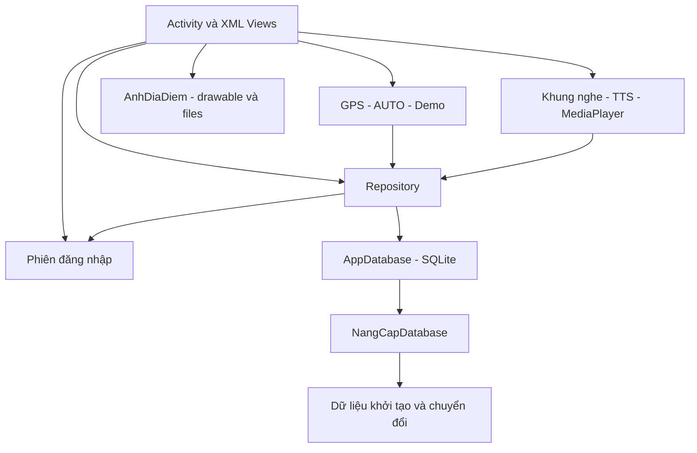

# APP_CK – Hỗ trợ tham quan và thuyết minh

Ứng dụng Android hỗ trợ tra cứu địa điểm, bản đồ OpenStreetMap, sơ đồ tương tác và thuyết minh tiếng Việt.

**Dữ liệu lưu bằng SQLite cục bộ, không có backend hoặc đồng bộ đa thiết bị.** Tài khoản và quyền quản trị có hiệu lực trên từng thiết bị.

Cập nhật theo mã nguồn và kết quả kiểm chứng đến **10/11/2026**.

README này giải thích cấu trúc và cách vận hành project để cài đặt, sử dụng, bảo trì và chuẩn bị bảo vệ. Những giới hạn hoặc phần chưa kiểm chứng được nêu riêng, không xem việc build thành công là bằng chứng mọi chức năng đã được nghiệm thu.

## Mục lục

- [Công nghệ](#công-nghệ)
- [Chức năng chính](#chức-năng-chính)
- [Dữ liệu mẫu](#dữ-liệu-mẫu)
- [Cài đặt và chạy](#cài-đặt-và-chạy)
- [SQLite và nguyên tắc dữ liệu](#sqlite-và-nguyên-tắc-dữ-liệu)
- [Cấu trúc mã nguồn](#cấu-trúc-mã-nguồn)
- [Kiến trúc và luồng xử lý](#kiến-trúc-và-luồng-xử-lý)
- [Các màn hình và cách sử dụng](#các-màn-hình-và-cách-sử-dụng)
- [Giải thích database](#giải-thích-database)
- [Đối chiếu chức năng với nơi lưu dữ liệu](#đối-chiếu-chức-năng-với-nơi-lưu-dữ-liệu)
- [GPS, AUTO và Demo](#gps-auto-và-demo)
- [Thuyết minh và lịch sử nghe](#thuyết-minh-và-lịch-sử-nghe)
- [Ảnh, tài nguyên và cấu hình](#ảnh-tài-nguyên-và-cấu-hình)
- [Kiểm tra dữ liệu và xử lý sự cố](#kiểm-tra-dữ-liệu-và-xử-lý-sự-cố)
- [Kiểm thử](#kiểm-thử)
- [Hạn chế còn lại](#hạn-chế-còn-lại)
- [Kịch bản trình diễn và kiến thức bảo vệ](#kịch-bản-trình-diễn-và-kiến-thức-bảo-vệ)

## Công nghệ

| Thành phần | Cấu hình |
| --- | --- |
| Giao diện | Java 11, Android Views/XML, Material Components |
| Android | minSdk 24, compileSdk/targetSdk 36 |
| Build | Gradle 9.6.0, AGP 8.9.2, Gradle Daemon dùng JDK 21 |
| Bản đồ | osmdroid 6.1.20, OpenStreetMap |
| Âm thanh | TextToSpeech, WAV tạm và MediaPlayer |
| Lưu trữ | SQLite v17, SharedPreferences cho phiên |

Chi tiết phiên bản: [app/build.gradle.kts](app/build.gradle.kts), [libs.versions.toml](gradle/libs.versions.toml).

## Chức năng chính

- Tìm kiếm không phân biệt dấu, lọc danh mục, gợi ý theo yêu thích và sắp xếp địa điểm gần người dùng.
- Xem thông tin, ảnh, nguồn tham khảo, vị trí và mở chỉ đường bằng ứng dụng/trình duyệt ngoài.
- Tham quan theo tầng/khu vực; chọn marker trên sơ đồ hoặc điểm trong danh sách.
- Nghe thủ công; AUTO chọn lọc theo GPS; Demo mô phỏng không cần quyền vị trí.
- Đăng ký, đăng nhập, sửa hồ sơ, đổi/khôi phục mật khẩu, yêu thích và lịch sử riêng theo tài khoản.
- ADMIN quản lý địa điểm, điểm thành phần, tầng/sơ đồ, marker, nội dung, ảnh, nguồn, GPS/AUTO và khóa/mở khóa tài khoản.

Khung nghe hỗ trợ phát, tạm dừng, tiếp tục, dừng, nghe lại và tua. Các luồng TTS trực tiếp ở trang chủ/AUTO chưa có cùng bộ điều khiển.

## Dữ liệu mẫu

| ID | Địa điểm | Điểm thành phần | Marker | Điểm AUTO mặc định |
| ---: | --- | ---: | ---: | ---: |
| 0 | Dinh Độc Lập | 25 | 25 | 0 |
| 1 | Bảo tàng Chứng tích Chiến tranh | 13 | 13 | 0 |
| 2 | Đại Nội Huế | 10 | 10 | 7 |
| 3 | Hệ thống Nhà tù Côn Đảo | 19 | 18 | 12 |
| 4 | Văn Miếu – Quốc Tử Giám | 16 | 16 | 3 |
| | **Tổng** | **83** | **82** | **22** |

Bảo tàng Côn Đảo, điểm ID 7 thuộc địa điểm ID 3, có nội dung nhưng chưa có marker riêng. ADMIN có thể thêm/sửa dữ liệu; địa điểm mới sử dụng tour dùng chung đọc SQLite.

Nội dung được biên soạn từ nguồn tham khảo, không phải bản thuyết minh được đơn vị quản lý chứng nhận. Bộ seed đối chiếu ngày 24/10/2026; nội dung vận hành đọc từ SQLite và không tự cập nhật từ website. Danh mục nguồn: [docs/nguon_noi_dung.md](docs/nguon_noi_dung.md).

## Cài đặt và chạy

Mở project bằng Android Studio, cấu hình Android SDK trong `local.properties` và đồng bộ Gradle. Thiết bị cần Android 7.0/API 24 trở lên.

Build từ PowerShell tại thư mục gốc; đổi đường dẫn JDK theo máy:

```powershell
$env:JAVA_HOME = "C:\Program Files\Android\Android Studio\jbr"
$env:PATH = "$env:JAVA_HOME\bin;$env:PATH"
.\gradlew.bat assembleDebug
```

APK của cấu hình hiện tại: `app/build/intermediates/apk/debug/app-debug.apk`.

Tra cứu và nghe thủ công không cần GPS. Bản đồ nền cần mạng/cache; nghe ngoại tuyến phụ thuộc giọng tiếng Việt đã cài trên thiết bị.

### Thiết lập ADMIN đầu tiên

1. Đăng ký tài khoản và lưu mã khôi phục.
2. Nhập tài khoản/mật khẩu tại màn hình đăng nhập.
3. Chọn **Thiết lập quản trị trên thiết bị**, xác nhận rồi đăng nhập lại.

Đăng ký thông thường tạo `USER`. Chỉ thiết lập được khi chưa có ADMIN; ADMIN bị khóa cũng chặn thiết lập lại. Không có mật khẩu quản trị mặc định. Chưa có giao diện đổi vai trò tùy ý cho tài khoản khác.

## SQLite và nguyên tắc dữ liệu

Database: **`du_lich_tai_khoan.db`, phiên bản 17**.

- [AppDatabase.java](app/src/main/java/com/example/app_ck/data/local/AppDatabase.java): helper và vòng đời kết nối.
- [NangCapDatabase.java](app/src/main/java/com/example/app_ck/data/local/NangCapDatabase.java): tạo/nâng cấp schema, chuyển dữ liệu cũ, kiểm tra toàn vẹn.
- Các bảng chính: `tai_khoan`, `dia_diem`, `diem_tham_quan_chung`, `so_do_tham_quan`, `yeu_thich`, `lich_su_nghe` và nhóm bảng nguồn.
- Điểm thành phần dùng khóa `(dia_diem_id,id)`; sơ đồ dùng `(dia_diem_id,tang)`. Marker ảnh X/Y tỷ lệ 0–1 độc lập với tọa độ GPS.
- Khóa ngoại và transaction bảo vệ liên kết. Lưu địa điểm/điểm cùng nguồn là một transaction; lỗi sẽ rollback. Bộ đếm cấp mã tránh tái sử dụng mã đã cấp qua repository từ v17.
- Xóa tầng bị chặn khi còn điểm; xóa điểm bị chặn khi có lịch sử; xóa địa điểm bị chặn khi còn điểm, yêu thích hoặc lịch sử.
- Mở lại app không seed đè chỉnh sửa. Nâng từ v15 trở lên không nạp lại dữ liệu mẫu đã xóa; bản ghi cũ mất liên kết được lưu snapshot trong `du_lieu_cach_ly` để đối chiếu.

Mật khẩu và mã khôi phục được băm. Repository kiểm tra quyền quản trị/chủ phiên; đăng xuất giữ dữ liệu cá nhân trong DB. Lịch sử ghi khi âm thanh bắt đầu, chống trùng mã lượt, phân biệt `MANUAL`, `AUTO_MAIN`, `AUTO_SUB`, `DEMO`.

Ảnh nhập từ thiết bị nằm trong `filesDir/anh_dia_diem`. Quy tắc backup giữ DB cùng ảnh, không phục hồi phiên đăng nhập; backup của Android không phải đồng bộ trong ứng dụng.

### Dữ liệu khi đẩy và kéo project từ Git

Git lưu mã nguồn và dữ liệu mẫu trong project, không lấy database SQLite đang nằm trong bộ nhớ riêng của app trên thiết bị.

- Chạy trên thiết bị cũ: cài cập nhật cùng package và chữ ký thường giữ dữ liệu. Gỡ app hoặc xóa dữ liệu ứng dụng sẽ xóa dữ liệu cục bộ.
- Cài mới trên thiết bị khác sau khi clone Git: app khởi tạo dữ liệu mẫu trong code; tài khoản, yêu thích, lịch sử và nội dung đã nhập trên thiết bị cũ không tự chuyển sang.
- Muốn giữ dữ liệu hiện tại: dùng script bên dưới để chuyển từ thiết bị cũ sang thiết bị mới. Bản sao lưu trong `.local-backups/` được Git bỏ qua; cần giữ bản sao riêng nếu chuyển máy tính. Script hiện yêu cầu kết nối được cả hai thiết bị.

Nếu muốn clone Git là có sẵn nội dung đã biên soạn, cần bổ sung bước xuất nội dung thành dữ liệu mẫu và nạp khi cài mới. Không đưa tài khoản và lịch sử cá nhân vào bộ dữ liệu mẫu dùng chung.

### Chuyển dữ liệu máy ảo ↔ máy thật bằng ADB

Script [transfer_sqlite.py](scripts/transfer_sqlite.py) chép database và ảnh nhập giữa hai thiết bị. **Dữ liệu máy đích bị thay thế, không gộp và không đồng bộ tự động.** Chạy các lệnh dưới đây trong PowerShell tại thư mục gốc project.

**1. Chuẩn bị:** cài Python, bật máy ảo, kết nối máy thật qua USB, bật USB debugging và chấp nhận thông báo cho phép máy tính truy cập. Cài cùng bản debug của app trên cả hai thiết bị, mở app ít nhất một lần để tạo database. Kiểm tra công cụ:

```powershell
python --version
& "D:\Android\Sdk\platform-tools\adb.exe" devices -l
```

Chỉ tiếp tục khi cả hai thiết bị có trạng thái `device`. Nếu hiện `unauthorized`, mở khóa điện thoại và chấp nhận kết nối. Nếu không tìm thấy ADB, đổi đường dẫn theo Android SDK trên máy; thêm `--adb "DUONG_DAN_ADB"` vào các lệnh script nếu đường dẫn khác mặc định.

**2. Kiểm tra trước khi chuyển:** thay `emulator-5554` và `SERIAL_MAY_THAT` bằng serial trong danh sách vừa lấy. `--source` là máy đang giữ dữ liệu cần lấy, `--target` là máy nhận dữ liệu.

```powershell
python .\scripts\transfer_sqlite.py --source emulator-5554 --target SERIAL_MAY_THAT
```

Lệnh này chỉ kiểm tra kết nối và quyền truy cập database, chưa chuyển dữ liệu. Script cần bản debug hỗ trợ `run-as`; không dùng bản release cho quy trình này.

**3. Chuyển từ máy ảo sang máy thật:** sau khi kiểm tra thành công, thêm `--apply`:

```powershell
python .\scripts\transfer_sqlite.py --source emulator-5554 --target SERIAL_MAY_THAT --apply
```

Script dừng app, sao lưu hai bên rồi chép database và ảnh từ máy nguồn. Database bao gồm tài khoản, nội dung đã chỉnh sửa, yêu thích và lịch sử. Sau khi báo `Transfer complete`, mở lại app trên máy thật và đăng nhập bằng tài khoản của máy nguồn; phiên đăng nhập cũ trên máy đích được xóa.

**4. Chuyển chiều ngược lại:** đổi nguồn và đích; lệnh này thay dữ liệu máy ảo bằng dữ liệu máy thật:

```powershell
python .\scripts\transfer_sqlite.py --source SERIAL_MAY_THAT --target emulator-5554
python .\scripts\transfer_sqlite.py --source SERIAL_MAY_THAT --target emulator-5554 --apply
```

**Bản sao lưu:** mỗi lần chạy với `--apply` tạo thư mục `.local-backups/sqlite-transfer/<thoi_diem>/`, chứa `source.tar` và `target-before-transfer.tar`. Giữ thư mục này riêng nếu cần chuyển máy tính; Git không lưu nó. Nếu chuyển thất bại, script cố gắng phục hồi dữ liệu máy đích; giữ bản sao lưu để xử lý khi thiết bị mất kết nối. Script chưa có lệnh nhập độc lập từ file `.tar`.

## Cấu trúc mã nguồn

Mã Java nằm trong `app/src/main/java/com/example/app_ck`:

```text
data/
  local/        # AppDatabase, NangCapDatabase
  model/        # Mô hình dữ liệu
  repository/   # Đọc/ghi SQLite
  seed/         # Dữ liệu khởi tạo
location/       # Nhận diện GPS, AUTO và Demo
narration/      # Khung nghe và lịch sử
session/        # Phiên đăng nhập, quyền và trạng thái
ui/             # Trang chủ, bản đồ, tour, tài khoản và quản trị
```

Layout: [app/src/main/res/layout](app/src/main/res/layout). Unit test: [app/src/test](app/src/test). Kiểm thử Android: [app/src/androidTest](app/src/androidTest).

## Kiến trúc và luồng xử lý

Ứng dụng dùng Activity và XML Views, model Java, repository thao tác SQLite và `SQLiteOpenHelper` quản lý database. Đây là cách phân lớp thực dụng; chưa phải MVVM hoàn chỉnh vì Activity còn xử lý nhiều logic giao diện, đọc dữ liệu và điều phối nghiệp vụ.



### Vai trò từng nhóm mã

| Nhóm/file | Trách nhiệm |
| --- | --- |
| `data/local/AppDatabase` | Tên/phiên bản DB, tạo/mở/nâng cấp, bật khóa ngoại; giữ một số API ủy quyền cho tương thích |
| `data/local/NangCapDatabase` | Điều phối schema, nhập dữ liệu cũ, củng cố toàn vẹn, cách ly bản ghi mất liên kết và cấp bộ đếm |
| `data/model/DiaDiem`, `DiemThamQuan` | Dữ liệu địa điểm và điểm thành phần; chuyển hàng SQLite thành đối tượng Java |
| `data/model/HoSoTaiKhoan`, `BaiThuyetMinh` | Hồ sơ và dữ liệu nội dung thuyết minh |
| `KhoDiaDiem`, `KhoDuLieuThamQuan` | Đọc địa điểm; CRUD điểm, sơ đồ, marker, GPS/AUTO; cấp mã và lưu cùng nguồn |
| `KhoTaiKhoan`, `KhoQuanTriTaiKhoan` | Đăng ký/xác thực, hồ sơ, khôi phục, thiết lập quản trị và trạng thái tài khoản |
| `KhoYeuThich`, `KhoLichSu` | Dữ liệu cá nhân, kiểm tra chủ phiên và chống ghi trùng lịch sử |
| `KhoNoiDungThamQuan`, `KhoNguonThongTin` | Đọc nội dung SQLite và nguồn tham khảo gắn với địa điểm/điểm |
| `KhoToaDoThamQuan` | Đọc các mốc AUTO từ bảng điểm chung, lưu phép đo qua quyền ADMIN |
| `data/seed` | Nội dung/sơ đồ/cấu hình mẫu và mã hỗ trợ dữ liệu cũ; không phải nơi ADMIN ghi thay đổi |
| `session/PhienDangNhap` | Giữ ID phiên; kiểm tra tài khoản hoạt động, vai trò và quyền sở hữu trong DB |
| `location` | Nhận vị trí, lọc mốc, điều phối hướng dẫn tự động và mô phỏng |
| `narration` | Chia nội dung, tạo/phát âm thanh, tua và ghi nhận lượt nghe |
| `ui/common` | Thành phần dùng chung: ảnh, nguồn, điều hướng, vòng đời khung nghe |
| `scripts/transfer_sqlite.py` | Công cụ Python chạy trên máy tính để chuyển DB/ảnh qua ADB; không nằm trong luồng chạy Android |

`data/local` hiện có **hai file**. Logic trước đây tách trong `ToanVenSQLite.java` và `ChuyenDoiDuLieuThamQuan.java` đã được gom vào `NangCapDatabase.java`; không cần tìm hai lớp cũ để sửa migration.

### Khi khởi động ứng dụng

1. Android mở `WelcomeActivity` từ launcher, sau đó người dùng đi vào các màn hình chức năng.
2. Khi code yêu cầu database, `AppDatabase` mở file riêng của ứng dụng. Chưa có file thì chạy `onCreate`; phiên bản cũ thì chạy `onUpgrade`.
3. Dữ liệu mẫu được nạp trong luồng tạo/chuyển đổi tương ứng. Mở lại DB hiện tại không chạy lại thao tác seed để đè chỉnh sửa ADMIN.
4. Repository đọc dữ liệu và giao diện hiển thị. Phiên tài khoản được đối chiếu trạng thái trong SQLite.

### Khi ADMIN lưu nội dung

1. Giao diện kiểm tra trường bắt buộc, tọa độ, ảnh và các giá trị nhập.
2. Ảnh chọn từ thiết bị được sao chép vào vùng riêng của app; DB giữ tham chiếu ảnh.
3. Repository kiểm tra quyền ADMIN đang hoạt động trong cùng connection/giao dịch ghi.
4. Thao tác tạo mới cấp mã; nội dung và nguồn được lưu trong transaction. Lỗi sẽ rollback thay đổi SQL.
5. Màn hình nạp lại dữ liệu. SQLite và file ảnh không thuộc cùng một transaction; việc dọn file ảnh không còn tham chiếu vẫn là phần cần cải thiện.

## Các màn hình và cách sử dụng

| Nhóm | Màn hình/lớp chính | Cách sử dụng |
| --- | --- | --- |
| Khởi động | `WelcomeActivity` | Vào ứng dụng và tiếp cận luồng trang chủ |
| Trang chủ | `MainActivity`, `KhamPhaActivity`, `GoiYDiaDiem` | Tìm/lọc địa điểm, xem gợi ý, sắp xếp gần tôi và mở chi tiết |
| Chi tiết | `ChiTietDiaDiemActivity` | Xem nội dung, ảnh, điểm thành phần, nguồn; mở bản đồ/tour và thao tác yêu thích |
| Bản đồ | `BanDoActivity`, `BanDoChaoMungView` | Xem vị trí, chọn địa điểm; bản đồ osmdroid khác với sơ đồ ảnh trong tour |
| Tham quan | `ThamQuanActivity`, các Activity tour riêng | Chọn tầng, marker hoặc điểm danh sách; xem/nghe nội dung; sử dụng AUTO/Demo theo cấu hình |
| Xác thực | `DangNhapActivity`, `DangKyActivity`, `QuenMatKhauActivity` | Tạo tài khoản, đăng nhập, dùng mã khôi phục khi quên mật khẩu |
| Cá nhân | `CaNhanActivity`, `SuaHoSoActivity`, `DoiMatKhauActivity` | Quản lý hồ sơ, mật khẩu và phiên |
| Dữ liệu cá nhân | `YeuThichActivity`, `LichSuActivity` | Xem yêu thích/lượt nghe của tài khoản hiện tại, mở lại nội dung hoặc xóa lịch sử |
| Trang quản trị | `AdminActivity` | Truy cập các nghiệp vụ quản trị trên thiết bị |
| Địa điểm | `QuanLyDiaDiemActivity` | Thêm/sửa/xóa địa điểm, nội dung tổng quan, ảnh và nguồn |
| Điểm thành phần | `QuanLyDiemThamQuanActivity` | Chọn địa điểm, thêm/sửa điểm, tầng, thứ tự, marker, nội dung, ảnh và cấu hình liên quan |
| Sơ đồ | `QuanLySoDo`, `SoDoChonMarkerView` | Thành phần hỗ trợ trong quản trị: quản lý tầng/ảnh và chọn vị trí marker; không phải Activity độc lập |
| Nội dung và AUTO | `QuanLyThuyetMinhActivity`, `QuanLyGpsAutoActivity` | Chỉnh thuyết minh, kiểm tra/cấu hình tọa độ và điều kiện phát tự động |
| Tài khoản | `QuanLyTaiKhoanActivity` | Tra cứu hồ sơ, khóa/mở khóa với các giới hạn bảo vệ tài khoản quản trị |

### Phân quyền

Người chưa đăng nhập vẫn có thể tra cứu và nghe các nội dung công khai; các thao tác dữ liệu cá nhân cần tài khoản. `USER` quản lý dữ liệu của mình. `ADMIN` có thêm quyền quản lý nội dung và tài khoản trên thiết bị đó.

Phiên được lưu bằng SharedPreferences `phien_dang_nhap`. Quyền không chỉ dựa vào việc ẩn nút: các API ghi quản trị kiểm tra `vai_tro='ADMIN'` và `trang_thai='ACTIVE'`. Đăng xuất xóa phiên, không xóa tài khoản, yêu thích hoặc lịch sử trong DB.

Mật khẩu dùng PBKDF2-HMAC-SHA1, 120.000 vòng, đầu ra 256 bit và salt ngẫu nhiên 16 byte. Đây là băm mật khẩu, không phải mã hóa toàn bộ database. Khôi phục dùng mã đã cấp, không gửi email/SMS vì hệ thống không có dịch vụ backend.

### Điều hướng tour

`DieuHuongThamQuan` chọn Activity theo ID địa điểm: 1 → Bảo tàng, 2 → Đại Nội Huế, 3 → Côn Đảo, 4 → Văn Miếu; các ID còn lại dùng `ThamQuanActivity`. Intent truyền `viTriDiaDiem` và `idMarker`. Địa điểm ADMIN thêm dùng giao diện chung, không phải viết thêm Activity riêng.

## Giải thích database

### Bảng vận hành

| Bảng | Nội dung và vai trò |
| --- | --- |
| `tai_khoan` | Tên đăng nhập, salt/hash mật khẩu, hash mã khôi phục, hồ sơ, vai trò, trạng thái và ngày tạo |
| `dia_diem` | Địa điểm lớn: tên, địa chỉ, mô tả tổng quan, danh mục, ảnh, GPS, bán kính AUTO và sơ đồ mặc định |
| `so_do_tham_quan` | Tầng/khu vực của từng địa điểm, tên và ảnh sơ đồ; khóa `(dia_diem_id,tang)` |
| `diem_tham_quan_chung` | Điểm thành phần: nội dung, ảnh, tầng, thứ tự, marker tỷ lệ, GPS và cờ cho phép AUTO |
| `yeu_thich` | Liên kết tài khoản–địa điểm; khóa ghép tránh yêu thích trùng |
| `lich_su_nghe` | Lượt bắt đầu nghe, tài khoản, địa điểm/điểm, chế độ, thời gian và mã lượt |
| `nguon_thong_tin` | Danh mục nguồn: mã, tên, URL và cơ quan |
| `bai_nguon` | Liên kết nguồn với bài tổng quan hoặc điểm, kèm thứ tự hiển thị |
| `ghi_chu_nguon` | Ghi chú biên soạn và ngày đối chiếu nguồn |
| `bo_dem_ma` | Bộ đếm theo loại/phạm vi, tránh cấp lại ID đã sử dụng qua repository |
| `du_lieu_cach_ly` | Snapshot dữ liệu mất liên kết được giữ khi nâng cấp để đối chiếu; không phải bảng rác |

### Các cột quan trọng của điểm tham quan

| Cột | Ý nghĩa |
| --- | --- |
| `dia_diem_id`, `id` | Khóa ghép: ID điểm chỉ duy nhất trong địa điểm, không duy nhất toàn ứng dụng |
| `ten`, `mo_ta`, `noi_dung_thuyet_minh` | Tên, phần giới thiệu ngắn và nội dung đọc |
| `tang`, `thu_tu` | Tầng/khu vực chứa điểm và thứ tự danh sách |
| `ten_anh` | Tên drawable hoặc tham chiếu `anh_may:<ten_file>.jpg` |
| `x_ty_le`, `y_ty_le` | Vị trí marker trên ảnh, trong khoảng 0–1; cùng null khi chưa gắn marker |
| `so_hien_thi` | Số hiển thị marker; không dùng thay cho khóa dữ liệu |
| `cho_phep_auto` | Có cho điểm tham gia nhận diện tự động hay không |
| `vi_do`, `kinh_do`, `ban_kinh`, `nguon_gps` | GPS thực tế, bán kính mét và ghi chú nguồn tọa độ |

Một điểm có thể có nội dung nhưng chưa có marker hoặc chưa được bật AUTO. Không suy ra GPS từ tọa độ ảnh. Khóa ngoại `(dia_diem_id,tang)` bảo đảm điểm thuộc sơ đồ/tầng của chính địa điểm đó.

### Bảng cũ và migration

Các bảng `khu_vuc`, `diem_tham_quan`, `thuyet_minh`, `gps_diem_tham_quan` còn phục vụ khởi tạo/chuyển đổi hoặc dọn liên kết cũ; màn hình hiện tại đọc điểm và AUTO từ `diem_tham_quan_chung`. Vì vậy thêm điểm trong ADMIN sẽ không làm bảng `diem_tham_quan` cũ có thêm dòng.

Database từng nâng cấp có thể còn `bao_tang_marker`, `dai_noi_hue_diem`, `con_dao_diem`, `van_mieu_diem`, `dai_noi_hue_toa_do`, `con_dao_toa_do`, `van_mieu_toa_do`. Migration có khả năng đọc các bảng này nếu tồn tại. Danh sách bảng thực tế phụ thuộc lịch sử cài đặt.

Không xóa bảng cũ trực tiếp bằng `DROP TABLE`: mã tạo/nâng cấp và xóa địa điểm còn tham chiếu một số bảng. Muốn bỏ cần migration phiên bản mới, sửa các điểm gọi và kiểm thử DB cũ lẫn cài mới. Không sửa các migration đã phát hành theo cách làm mất khả năng chuyển dữ liệu người dùng.

### Lưu bền và xóa dữ liệu

- Đóng/mở hoặc khởi động lại app không làm mất các thay đổi đã commit.
- Cài cập nhật cùng package/chữ ký thường giữ dữ liệu; gỡ app hoặc chọn Clear storage sẽ xóa vùng dữ liệu cục bộ. Android có thể phục hồi từ backup tùy thiết lập hệ thống.
- Xóa địa điểm không tự xóa toàn bộ dữ liệu con; repository chặn khi còn điểm, yêu thích hoặc lịch sử.
- Xóa điểm bị chặn khi lịch sử còn tham chiếu; xóa tầng bị chặn khi còn điểm. Cần xử lý dữ liệu liên quan theo luồng hợp lệ trước.
- Transaction chỉ commit khi toàn bộ phần SQL cần thiết thành công. Khóa ngoại và các ràng buộc/trigger bổ sung bảo vệ liên kết, không thay thế kiểm tra đầu vào và quyền.

## Đối chiếu chức năng với nơi lưu dữ liệu

Bảng sau dùng để xác định đúng nơi kiểm tra sau khi thao tác trong app. Mã nguồn hiện tại là căn cứ cho tên bảng/cột; tài liệu báo cáo là mô tả tham khảo và có thể phản ánh phiên bản trước.

| Thao tác trên giao diện | Bảng/file thay đổi | Cách xác định bản ghi |
| --- | --- | --- |
| ADMIN thêm/sửa địa điểm | `dia_diem`; nguồn tương ứng trong nhóm bảng nguồn | `dia_diem.id` |
| ADMIN thêm/sửa điểm thành phần | `diem_tham_quan_chung`; nguồn tương ứng trong nhóm bảng nguồn | Cặp `dia_diem_id` và `id` |
| Sửa thuyết minh tổng quan | `dia_diem.mo_ta` | ID địa điểm; các API nội dung dùng điểm 0 để chỉ tổng quan |
| Sửa thuyết minh điểm | `diem_tham_quan_chung.noi_dung_thuyet_minh` | Cặp địa điểm–điểm |
| Thêm/sửa tầng và ảnh sơ đồ | `so_do_tham_quan` | Cặp `dia_diem_id` và `tang` |
| Gắn/di chuyển marker trên sơ đồ | Các cột `x_ty_le`, `y_ty_le` của `diem_tham_quan_chung` | Điểm đang chọn; tọa độ tỷ lệ theo ảnh |
| Cấu hình GPS AUTO MAIN | `dia_diem.vi_do`, `kinh_do`, `ban_kinh_auto` | ID địa điểm chính |
| Cấu hình GPS AUTO điểm thành phần | `diem_tham_quan_chung.vi_do`, `kinh_do`, `ban_kinh`, `cho_phep_auto`, `nguon_gps` | Cặp địa điểm–điểm |
| Chọn ảnh mới từ thiết bị | File trong `files/anh_dia_diem/`; tham chiếu ở cột ảnh của địa điểm/điểm/sơ đồ | Tên file UUID tương ứng giá trị `anh_may:` |
| Thêm/bỏ yêu thích | `yeu_thich` | Cặp `tai_khoan_id`, `dia_diem_id` |
| Bắt đầu phát nội dung khi có tài khoản hợp lệ | `lich_su_nghe` | Tài khoản và mã lượt; không phải chỉ mở cửa sổ nghe |
| Đăng ký/sửa hồ sơ/đổi mật khẩu/khóa tài khoản | `tai_khoan` | ID hoặc tên đăng nhập theo nghiệp vụ |
| Đăng nhập/đăng xuất | SharedPreferences `phien_dang_nhap` | Phiên trên đúng thiết bị; không có bảng phiên riêng |
| Tải ô bản đồ | Cache osmdroid, có thể thấy `cache.db` và bảng `tiles` | Không phải dữ liệu nội dung `du_lich_tai_khoan.db` |

### Ví dụ cấu hình GPS của Dinh Độc Lập

Ở màn hình **Cấu hình GPS AUTO**, chọn **Dinh Độc Lập → Địa điểm chính · AUTO MAIN** rồi lưu: `QuanLyGpsAutoActivity` gọi `KhoDuLieuThamQuan.luuCauHinhAuto` với điểm 0. Repository chuyển thao tác sang cập nhật `dia_diem`; không ghi vào bảng cũ `gps_diem_tham_quan`.

Kiểm tra các giá trị đã lưu:

```sql
SELECT id, ten, vi_do, kinh_do, ban_kinh_auto
FROM dia_diem
WHERE id = 0;
```

Nếu chọn một điểm thành phần thay cho AUTO MAIN, xem bảng chung:

```sql
SELECT dia_diem_id, id, ten, cho_phep_auto,
       vi_do, kinh_do, ban_kinh, nguon_gps
FROM diem_tham_quan_chung
WHERE dia_diem_id = 0
ORDER BY thu_tu, id;
```

Lưu GPS không di chuyển marker X/Y, không tự bật GPS và không lập tức phát thuyết minh. AUTO MAIN được nhận diện trong luồng GPS trang chủ, còn điểm thành phần phụ thuộc luồng tour và trạng thái cho phép AUTO. Không dùng tên địa điểm hoặc số hiển thị marker để thay cho ID khi truy vấn.

### Ví dụ quản lý sơ đồ và ảnh điểm

Trong quản lý điểm, chọn địa điểm trước khi mở **Sơ đồ và tầng/khu vực**. `QuanLySoDo` cho thêm mã tầng mới, sửa tên/ảnh của tầng có sẵn hoặc xóa tầng trống. Mã tầng hiện có không được đổi trực tiếp trong form sửa; điểm đang dùng tầng được bảo vệ bởi liên kết và kiểm tra repository.

```sql
SELECT dia_diem_id, tang, ten, ten_anh
FROM so_do_tham_quan
ORDER BY dia_diem_id, tang;

SELECT dia_diem_id, id, ten, tang, ten_anh, x_ty_le, y_ty_le
FROM diem_tham_quan_chung
WHERE dia_diem_id = 2
ORDER BY thu_tu, id;
```

Truy vấn thứ hai xem các điểm Đại Nội Huế, gồm ảnh riêng và marker. Nếu `ten_anh` rỗng hoặc ảnh không đọc được, khung nghe có thể dùng ảnh tổng quan được truyền vào. Lưu ảnh của địa điểm chính không đồng nghĩa mỗi điểm đã có ảnh riêng; cần chỉnh đúng điểm trong ADMIN.

## GPS, AUTO và Demo

| Thành phần | Vai trò |
| --- | --- |
| `ThamQuanTuDong` | Điều phối hướng dẫn nhận diện địa điểm từ trang chủ |
| `HuongDanTour`, `HuongDanConDao` | Điều phối hướng dẫn trong tour và phần chuyên biệt Côn Đảo |
| `BoNhanDienDiaDiem` | Nhận diện địa điểm lớn |
| `BoNhanDienDiemThanhPhan` | Chỉ xét các điểm AUTO của tour đang mở, loại tình huống vùng sai số chạm nhiều mốc |
| `BoChonDiemTuDong` | Khoảng cách, vùng phát, chờ ổn định và chống lặp trong lượt |
| `CauHinhAutoDiSan`, `CauHinhAutoConDao` | Cấu hình hỗ trợ tour và cấu hình mẫu tương ứng |

Luồng GPS: xin quyền → nhận vị trí → kiểm tra chất lượng/thời gian → đối chiếu mốc đủ điều kiện → chờ ổn định → chọn điểm và phát → đánh dấu đã phát. Bộ chọn dùng công thức khoảng cách theo tọa độ địa lý, không đo pixel ảnh.

Trong bộ chọn điểm, vị trí sai số trên 25 m, cũ hơn 15 giây hoặc không mới hơn lần trước bị loại. Vùng sai số phải nằm trong bán kính mốc; ứng viên cần ổn định ít nhất 2,5 giây. Các vùng mơ hồ được yêu cầu chọn thủ công. Điều kiện cụ thể còn phụ thuộc bộ nhận diện và ngữ cảnh tour; không xem AUTO là định vị chính xác từng phòng trong nhà.

Demo mô phỏng lựa chọn/di chuyển trong luồng hướng dẫn để trình diễn khi không ở địa điểm thực tế. Demo không chứng minh chất lượng GPS thực địa. Khi rời màn hình, luồng hướng dẫn dừng theo vòng đời; chưa có dịch vụ nghe/định vị nền.

Chức năng **Gần tôi** chỉ sắp xếp địa điểm theo vị trí, khác với AUTO phát thuyết minh. Nhánh Android dưới 11 dùng vị trí gần nhất và còn cần kiểm tra độ cũ/fallback tốt hơn.

## Thuyết minh và lịch sử nghe

`KhoNoiDungThamQuan` đọc nội dung vận hành từ SQLite. Điểm ID 0 trong một số API biểu thị bài tổng quan, còn điểm thành phần lưu trong bảng chung có ID dương.

Khung nghe thủ công `KhungNgheThuyetMinh` hoạt động như sau:

1. Nhận tên/nội dung và thông tin địa điểm/điểm.
2. Ưu tiên ảnh riêng của điểm đọc từ SQLite; nếu chưa đọc được thì dùng ảnh được màn hình truyền vào, thường là ảnh tổng quan.
3. `DoanAmThanh` chia bài dài thành đoạn phù hợp giới hạn TTS.
4. TextToSpeech tổng hợp các đoạn thành WAV tạm trong cache; có kiểm tra giọng tiếng Việt và timeout chuẩn bị.
5. MediaPlayer phát âm thanh; tổng thời lượng các đoạn dùng cho thanh tua, tạm dừng/tiếp tục và nghe lại.
6. Khung nghe xử lý audio focus và sự kiện ngắt tai nghe; đóng khung/hủy màn hình sẽ dọn tài nguyên theo vòng đời.

TTS không phải file thu âm có sẵn. Chất lượng/khả năng nghe offline phụ thuộc engine và giọng đã cài; app ưu tiên giọng tiếng Việt không cần mạng khi khả dụng. Âm thanh cache không phải gói thuyết minh tải về dùng lâu dài.

`LuotNgheLichSu` gắn lượt nghe với tài khoản; lịch sử ghi khi bắt đầu phát, không phải chỉ bấm mở khung. `ma_luot` cùng ID tài khoản chống ghi trùng. Các chế độ lưu gồm `MANUAL`, `AUTO_MAIN`, `AUTO_SUB`, `DEMO`. Lượt tổng quan dùng `diem_id` null trong DB. Lịch sử chưa phải thống kê đã nghe hết bài; thanh tiến trình tour cũng không phải tỷ lệ hoàn thành nghe.

Các luồng TTS trực tiếp của trang chủ/AUTO chưa dùng đầy đủ bộ điều khiển giống khung nghe thủ công. Cần kiểm tra thêm rút tai nghe hoặc mất audio focus trong lúc đang chuẩn bị, không chỉ khi âm thanh đã phát.

## Ảnh, tài nguyên và cấu hình

### Nơi lưu ảnh

| Loại | Vị trí | Cách tham chiếu |
| --- | --- | --- |
| Ảnh đi kèm APK | `app/src/main/res/drawable/` | Tên resource không có đuôi, ví dụ tên ảnh seed |
| Ảnh ADMIN nhập | `filesDir/anh_dia_diem/` trên thiết bị | `anh_may:<uuid>.jpg` trong SQLite |
| Sơ đồ | Drawable hoặc cùng thư mục ảnh nhập | `so_do_tham_quan.ten_anh` và cấu hình sơ đồ liên quan |

`AnhDiaDiem` đọc được cả drawable và ảnh cục bộ. Khi nhập, ảnh được giải mã giảm kích thước phù hợp, nén JPEG và lưu bằng tên UUID; DB không chứa bitmap. Chuyển DB mà bỏ ảnh sẽ làm hỏng các tham chiếu `anh_may:`. Ảnh đã nhúng trong APK cần cùng tài nguyên tương ứng trên hai thiết bị.

Đường dẫn ảnh nhập thông thường:

```text
/data/user/0/com.example.app_ck/files/anh_dia_diem/
```

Trong Device Explorer có thể thấy đường dẫn tương đương `/data/data/com.example.app_ck/files/anh_dia_diem/`. Đây là dữ liệu trong máy ảo/điện thoại, không tự xuất hiện trong cây source trên máy tính.

### File cấu hình và tài nguyên

| File/thư mục | Ý nghĩa |
| --- | --- |
| `app/src/main/AndroidManifest.xml` | Khai báo màn hình, launcher, quyền Internet/vị trí và chính sách backup; các Activity nội bộ không export |
| `app/src/main/res/layout/` | Bố cục màn hình, item và khung nghe |
| `app/src/main/res/values/` | Chuỗi, màu, theme và ID; `auto_ids.xml` giữ ID dùng từ code, không tự kết luận là thừa chỉ vì không có layout tham chiếu |
| `app/src/main/res/xml/backup_rules.xml`, `data_extraction_rules.xml` | Giữ DB cùng ảnh nhập khi backup/transfer của Android, không đưa phiên đăng nhập vào tập include |
| `app/build.gradle.kts` | applicationId, SDK, Java, buildTypes và dependency của module |
| `gradle/libs.versions.toml` | Danh mục phiên bản thư viện/plugin |
| `gradle/wrapper/gradle-wrapper.properties`, `gradlew`, `gradlew.bat` | Gradle Wrapper để build theo phiên bản project; `.bat` dành cho Windows |
| `gradle/gradle-daemon-jvm.properties` | Tiêu chí JVM cho Gradle daemon; hiện chọn Java 21, khác Java 11 của source |
| `local.properties` | Đường dẫn SDK theo máy, không chia sẻ cấu hình tuyệt đối này qua Git |
| `.gitignore` | Loại file sinh ra, cấu hình cục bộ và `.local-backups/` khỏi Git |
| `docs/nguon_noi_dung.md` | Danh mục nguồn tham khảo nội dung |

Quyền Internet phục vụ bản đồ và truy cập ngoài; quyền vị trí phục vụ GPS. Không cần xin quyền vị trí để tra cứu/nghe thủ công. Ảnh chọn từ thiết bị được đọc qua URI và sao chép về vùng riêng.

## Kiểm tra dữ liệu và xử lý sự cố

### Xem bảng SQLite đang sử dụng

Trong Android Studio, mở **View → Tool Windows → App Inspection**, chọn đúng thiết bị/tiến trình `com.example.app_ck`, rồi mở **Database Inspector → du_lich_tai_khoan.db**. Trên bản debug, dùng các truy vấn chỉ đọc:

```sql
SELECT name FROM sqlite_master WHERE type='table' ORDER BY name;
SELECT id, ten FROM dia_diem ORDER BY id;
SELECT dia_diem_id, id, ten, ten_anh
FROM diem_tham_quan_chung ORDER BY dia_diem_id, thu_tu, id;
PRAGMA user_version;
PRAGMA quick_check;
PRAGMA foreign_key_check;
```

`user_version` hiện là 17; `quick_check` mong đợi `ok`; `foreign_key_check` không trả dòng khi không có vi phạm. `PRAGMA foreign_keys` là thiết lập theo connection, không dùng kết quả ở một connection ngoài để kết luận helper của ứng dụng có bật hay không.

| Hiện tượng | Kiểm tra/xử lý |
| --- | --- |
| ADMIN thêm điểm nhưng bảng cũ không đổi | Xem `diem_tham_quan_chung`, chọn đúng thiết bị; Refresh hoặc bật Live updates |
| DB hiện `(closed)` | App đã đóng connection sau truy vấn; bật Keep database connections open nếu IDE hỗ trợ, rồi mở lại màn hình truy cập DB. Không suy ra đã mất dữ liệu |
| Chỉ thấy `cache.db`/`tiles` | Đây là cache bản đồ; database nội dung có tên `du_lich_tai_khoan.db` |
| Không thấy `.local-backups` trong cây Android | Chuyển chế độ cây thư mục từ Android sang Project hoặc mở đường dẫn bằng File Explorer |
| Không thấy ảnh ADMIN | Kiểm tra `ten_anh`, file ảnh nhập trên đúng thiết bị và việc chép cả thư mục ảnh; điểm chưa có ảnh riêng có thể hiển thị ảnh tổng quan |
| TTS không đọc tiếng Việt | Kiểm tra engine/giọng tiếng Việt và khả năng offline trong cài đặt thiết bị |
| AUTO không phát | Kiểm tra quyền, GPS, cờ AUTO, tọa độ/bán kính, chất lượng vị trí và việc điểm đã phát trong lượt; thử Demo/chọn thủ công |
| Không xóa được địa điểm/điểm/tầng | Kiểm tra các liên kết đang được bảo vệ trước khi xóa |
| ADB không thấy máy thật | Bật USB debugging, cho phép máy tính, kiểm tra cáp và trạng thái `device` trong `adb devices -l` |
| Script báo không dùng được `run-as` | Cần cùng bản debug trên hai thiết bị và mở app ít nhất một lần; bản release không thuộc quy trình chuyển này |

File DB xuất ra là bản chụp, không tự cập nhật theo ứng dụng. Để mở ảnh nhập bằng Device Explorer: chọn thiết bị → `data/data/com.example.app_ck/files/anh_dia_diem`. Truy cập thư mục riêng phụ thuộc chế độ debug và khả năng thiết bị/công cụ.

## Kiểm thử

```powershell
.\gradlew.bat assembleDebug testDebugUnitTest lintDebug
.\gradlew.bat connectedDebugAndroidTest
```

Kiểm thử Android cần emulator/thiết bị online. Dùng emulator riêng và xem setup/cleanup trước khi chạy toàn bộ bộ test.

Kết quả kiểm chứng trong phiên làm việc ngày **10/11/2026**:

- Build debug và **37 unit test đạt** sau sửa ưu tiên ảnh điểm trong khung nghe và ảnh danh sách điểm.
- Lint lần chạy gần nhất: **0 lỗi, 768 cảnh báo**; nhóm nhiều gồm HardcodedText, IconLocation, UnusedResources, SetTextI18n, Autofill và Overdraw. Không xóa resource hàng loạt theo Lint vì có tra cứu tên động.
- **34 ca Android đã đạt ở đợt sau gom `data/local`** cho migration, rollback, toàn vẹn SQLite, lịch sử, nội dung và quản trị/tour. Chưa chạy lại toàn bộ sau sửa ảnh; đây không phải toàn bộ androidTest.
- Đã chuyển SQLite v17 và ảnh từ máy ảo sang Samsung bằng script, đối chiếu file với bản sao nguồn. Lần kiểm tra DB điện thoại ghi nhận `quick_check=ok`, 5 địa điểm, 83 điểm và 2 tài khoản; số tài khoản là dữ liệu tại thời điểm kiểm tra, không phải tài khoản mẫu mặc định.

Báo cáo nằm trong `app/build/reports/`; kết quả Android tại `app/build/outputs/androidTest-results/`. Các báo cáo có thể bị ghi đè khi chạy lại.

Các nhóm unit test bao phủ bộ chọn/nhận diện AUTO, lời mời thuyết minh, chia/tua đoạn âm thanh, gợi ý và dữ liệu nội dung. Android test kiểm tra integration với SQLite, migration, quyền, UI và các luồng tour tương ứng. Test tên `*FlowTest` có thể thao tác giao diện/dữ liệu; đọc setup/cleanup trước khi chạy trên thiết bị đang giữ dữ liệu cần bảo toàn.

Nếu cài APK debug hiện tại bằng ADB và gặp `INSTALL_FAILED_TEST_ONLY`, dùng `install -r -t` trên đúng thiết bị. `-r` cài đè giữ dữ liệu khi package/chữ ký tương thích; không gỡ app để khắc phục lỗi này nếu chưa sao lưu.


## Kịch bản trình diễn và kiến thức bảo vệ

### Kịch bản kiểm tra xuyên suốt

1. Mở app, tìm một địa điểm, xem nội dung/nguồn và mở bản đồ.
2. Đăng ký/đăng nhập USER, thêm yêu thích; mở tour, chọn marker/danh sách và nghe thủ công.
3. Thử tạm dừng, tiếp tục, tua, dừng; kiểm tra lịch sử được ghi cho đúng tài khoản.
4. Chạy Demo khi không ở địa điểm thực tế. Trình bày riêng rằng GPS thật cần quyền và vị trí đủ chính xác.
5. Đăng nhập ADMIN, thêm hoặc sửa nội dung/ảnh điểm, mở lại màn hình người dùng để kiểm tra thay đổi từ SQLite.
6. Đóng/mở app, xác nhận dữ liệu đã lưu còn nguyên. Có thể kiểm chứng bằng truy vấn bảng chung.
7. Nếu trình diễn chuyển thiết bị, sao lưu trước, phân biệt rõ nguồn/đích và đăng nhập lại sau khi chép. Chỉ dùng dữ liệu thử được phép thay thế.

### Những câu hỏi cần giải thích được

| Câu hỏi | Nội dung cần nắm |
| --- | --- |
| Vì sao chọn SQLite? | Phù hợp lưu trữ cục bộ, quan hệ và transaction; chạy không cần server. Phạm vi hiện không yêu cầu đồng bộ trực tuyến |
| Dữ liệu ADMIN thay đổi nằm ở đâu? | DB và ảnh trong vùng riêng của app trên thiết bị; không sửa file seed Java hoặc tự đẩy lên Git |
| Vì sao clone Git không có dữ liệu mới nhập? | Git chứa source/seed/resource, không chứa trạng thái database đang chạy; cần chuyển DB cùng ảnh hoặc xây dựng luồng xuất nội dung mẫu |
| ID điểm có duy nhất toàn hệ thống không? | Không; cần cặp địa điểm–điểm. Lịch sử, nguồn và điều hướng phải giữ đúng ngữ cảnh |
| Marker khác GPS thế nào? | Marker là tỷ lệ vị trí trên ảnh; GPS là tọa độ địa lý và bán kính mét, phục vụ nhận diện thực địa |
| Transaction và khóa ngoại giải quyết gì? | Transaction tránh lưu dở các thao tác SQL liên quan; khóa ngoại bảo vệ liên kết, kết hợp kiểm tra nghiệp vụ và quyền |
| Tại sao còn bảng cũ? | Giữ đường chuyển đổi/tương thích; dữ liệu vận hành đã chuyển sang bảng chung, bỏ bảng phải có migration |
| Vì sao có bảng DB đóng trong Inspector? | Connection có thể đóng sau truy vấn trong try-with-resources; file đã lưu vẫn tồn tại |
| Lịch sử chứng minh nghe hết chưa? | Chưa; ghi nhận bắt đầu phát và chế độ, không phải hoàn tất nội dung |
| Có chạy hoàn toàn offline không? | Nội dung SQLite và giọng TTS offline đã cài có thể dùng; bản đồ nền cần mạng/cache, chưa có gói offline đầy đủ |
| ADMIN có hiệu lực trên mọi máy không? | Không; vai trò thuộc DB từng thiết bị. Chép toàn bộ DB là chép cả tài khoản/quyền, không phải dịch vụ quản trị tập trung |
| Script Python có bắt buộc để app chạy không? | Không; chỉ hỗ trợ phát triển/chuyển dữ liệu qua máy tính. Xóa script không làm app mất chức năng Android |

Khi mô tả kết quả, tách chức năng đã có trong code, phần đã test tự động và phần đã nghiệm thu thực địa. Không coi Demo GPS, build thành công hoặc kiểm tra một thiết bị là bằng chứng ứng dụng đã sẵn sàng cho mọi điều kiện sử dụng.
