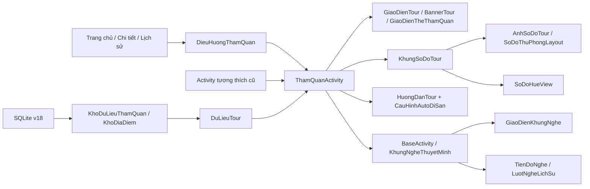

# Refactor kiến trúc tham quan — 19/11/2026

## Baseline trước chỉnh sửa

- Commit nguồn: `4cace38`, nhánh `Giaodienmoi`, working tree sạch.
- Nhánh làm việc: `refactor/tour-architecture`, tạo từ `Giaodienmoi` để bảo toàn giao diện vừa hoàn thiện; không chuyển về `main`.
- `./gradlew.bat assembleDebug testDebugUnitTest`: **BUILD SUCCESSFUL** (19 giây).
- ADB ban đầu không có thiết bị. Khởi động AVD `Medium_Phone_API_37.0` tại `emulator-5580` với `-read-only -no-snapshot -no-window`; dữ liệu máy ảo gốc không bị lưu đè.
- `./gradlew.bat connectedDebugAndroidTest`: **lỗi biên dịch có sẵn**, ba tham chiếu đến ID đã bỏ: `navGoiY` (hai chỗ trong `CaNhanVaDieuHuongTest`) và `ytDangXuat` (`TaiKhoanVaYeuThichFlowTest`). Log: `build/refactor-baseline-android.log`.
- SQLite thực tế đang là **version 18**; README cũ ghi 17. Refactor không thay schema, version, seed, tọa độ hay nội dung.

## Kiểm kê trước chỉnh sửa

| File hiện tại | Trách nhiệm | Vấn đề | Hướng xử lý | Rủi ro |
|---|---|---|---|---|
| `BaoTangThamQuanActivity` | Giá trị mặc định Intent | Đã dùng luồng chung | Giữ tương thích đường vào cũ | Thấp |
| `HuongDanConDao` | Adapter AUTO Côn Đảo | Chỉ truyền cờ đổi ID điều khiển | Chuyển cờ thành cấu hình cho `HuongDanTour` | Thấp |
| `DieuHuongThamQuan` | Chọn Activity theo địa điểm | Phân nhánh năm màn hình | Intent chung, giữ nguyên extras | Thấp |
| `GiaoDienTheThamQuan` | Style thẻ cũ | Không còn caller; style khác thẻ mới | Tái sử dụng tên/lớp cho phần dựng thẻ mới tách từ `GiaoDienTour` | Thấp |
| `MainActivity`, `BanDoActivity`, `GoiYDiaDiem` | Tìm kiếm/gợi ý | Lặp chuẩn hóa tiếng Việt | Dùng tiện ích chuẩn hóa chung, giữ điều kiện lọc | Thấp |
| `KhoDiaDiem`, `CauHinhAutoDiSan` | Đọc địa điểm/cấu hình | Tour truy vấn lặp cùng danh sách | Đọc snapshot dữ liệu và tạo cấu hình từ dữ liệu đó | Thấp–vừa |
| `ThamQuanActivity` (844 dòng) | UI, SQLite, tầng, chọn điểm, TTS | Nhiều trách nhiệm, chuyển tiếp tới tour riêng | Điều phối chung; tách dữ liệu và dựng sơ đồ | Vừa |
| `ConDaoThamQuanActivity` (600 dòng) | Tour Côn Đảo | Lặp state, danh sách song song, TTS/lifecycle | Dùng màn hình chung với cờ Côn Đảo | Vừa |
| `VanMieuThamQuanActivity` (590 dòng) | Tour Văn Miếu | Lặp như Côn Đảo | Dùng màn hình chung | Vừa |
| `DaiNoiHueThamQuanActivity` (1.106 dòng) | Tour Huế + Canvas/gesture | View phụ thuộc state Activity qua inner class | Tách `SoDoHueView`; giữ nguyên công thức zoom/pan/touch | Cao |
| `GiaoDienTour` (1.596 dòng) | Header, tab, tìm kiếm, thẻ, toàn màn hình | Dựng thẻ và banner làm lớp quá lớn | Tách trách nhiệm, giữ nguyên style và callback nghe nhanh | Vừa |
| `AnhSoDoTour`, `GiaoDienSoDo`, `SoDoThuPhongLayout` | Ảnh, marker, zoom và công cụ | Đang dùng lại tốt; cần quản lý bitmap khi thay sơ đồ | Giữ thuật toán, bổ sung giải phóng đúng chủ sở hữu | Vừa |
| `BaseActivity` | Khung nghe, nguồn, lịch sử, xác nhận, insets | Nơi tập trung tích hợp hiện có | Tái sử dụng; bảo vệ callback theo lifecycle | Vừa |
| `KhungNgheThuyetMinh` (2.778 dòng) | TTS/WAV/player/UI/tiến độ | Lưu tiến độ lẫn với UI/player | Tách lưu tiến độ, giữ khóa và quy tắc phiên | Vừa |
| `QuanLy*`, `KhoDuLieuThamQuan` | CRUD, validation, nguồn, GPS | Repository đã tập trung quyền/transaction; Activity vẫn đọc chi tiết lặp | Dùng API đọc chung, giữ validation/transaction đang có | Vừa |
| `AppDatabase`, `NangCapDatabase`, seed | Vòng đời/migration/dữ liệu | Đã phân tách, có test bảo toàn | Giữ nguyên | Cao nếu thay |
| Layout/drawable và các màn hình còn lại | UI hoàn thiện + ảnh nạp động | Có tra cứu `getIdentifier`, `_sach` và tên trong SQLite/seed | Không xóa tài nguyên theo tham chiếu tĩnh hoặc Lint đơn thuần | Cao nếu xóa nhầm |
| `androidTest` | Kiểm tra tích hợp | Một số test còn giả định cấu trúc UI/private field cũ | Cập nhật cách truy cập, giữ assertion hành vi | Vừa |

## Nguyên tắc triển khai

Một `ThamQuanActivity` điều phối dữ liệu SQLite, lựa chọn và âm thanh. Khác biệt sơ đồ Huế và ID điều khiển Côn Đảo đi qua cấu hình. Giữ các lớp Activity cũ mỏng để Intent đã lưu và test/đường vào nội bộ tiếp tục mở đúng địa điểm. Không đổi layout/drawable, thuật toán nhận diện, bán kính, thứ tự DEMO hay chống phát lặp.

## Kiến trúc sau refactor

Trước đây Côn Đảo, Huế và Văn Miếu giữ các mảng ID/tên/nội dung song song và sao chép logic lựa chọn, TTS, quyền vị trí, lịch sử và lifecycle. Mỗi địa điểm có đường điều phối riêng; `GiaoDienTour` đồng thời dựng banner, thẻ, tìm kiếm và toàn màn hình.

Hiện mọi đường điều hướng mới mở `ThamQuanActivity`. Activity đọc `DuLieuTour`, cập nhật điểm/tầng và điều phối bộ hướng dẫn chung. Các Activity cũ chỉ cung cấp ID mặc định để duy trì component Intent cũ. Cấu hình không chứa tên/số điểm/GPS cố định; những thông tin này đọc từ SQLite. Bảo tàng giữ điểm mở mặc định 10 của Intent cũ.



`KhungSoDoTour` chỉ dựng lại khi đổi tầng hoặc nạp lại dữ liệu. Chọn điểm trên cùng sơ đồ chỉ cập nhật marker, giữ nguyên view và zoom. Bộ vẽ Huế được chuyển nguyên công thức phép biến đổi, giới hạn kéo, ngưỡng gesture và bán kính chạm; nhận danh sách marker và callback thay vì đọc state của inner Activity.

AUTO Côn Đảo vẫn dùng thuật toán `HuongDanTour` đã có, với cờ giữ nguyên các ID `conDao*`. Không thay `BoChonDiemTuDong`, hai bộ nhận diện, chu kỳ DEMO, bán kính hay cờ AUTO. Khi chọn nghe nhanh, yêu cầu nghe được chụp trước callback xác nhận; chỉ đổi điểm/phát bài sau khi đồng ý. Callback của hộp thoại cũ bị bỏ qua khi hộp thoại đã đóng, kể cả Activity đã quay lại RESUMED.

Ngoài tour, `BoAnhDiaDiem` sở hữu slider/thư viện ảnh và tác vụ hẹn giờ; Activity chi tiết giữ điều hướng, nội dung và yêu thích. `GiaoDienKhungNghe` sở hữu kích thước sheet, sóng âm và hộp đọc bài; trình phát giữ state machine TTS/WAV/MediaPlayer/audio focus. `TienDoNghe` giữ nguyên tên SharedPreferences, khóa SHA-256 và quy tắc tài khoản/chế độ cũ. Tìm kiếm trang chủ, bản đồ, tour và gợi ý dùng `VanBanTimKiem`, giữ riêng quy tắc khoảng trắng của gợi ý.

`ThamQuanTuDong` ở trang chủ vẫn giữ luồng nhận diện địa điểm MAIN và lời mời mở chi tiết; `HuongDanTour` xử lý điểm thành phần SUB trong tour. Hai trách nhiệm này không bị ép thành một controller. Các kiểm tra quyền ADMIN và validation ở repository ghi, transaction lưu nguồn/nội dung, cơ chế chống xóa dữ liệu có liên kết cũng giữ nguyên.

## Đối chiếu file và trách nhiệm

| File cũ | File sau refactor | Hành động | Lý do |
|---|---|---|---|
| `ThamQuanActivity` và logic trong ba Activity di sản | `ThamQuanActivity` | Hợp nhất | Một luồng lựa chọn, trước/sau, quyền, TTS, lịch sử, lifecycle |
| Bốn Activity địa điểm | Giữ tên class cũ, mỗi lớp chỉ trả ID mặc định | Giữ tương thích | Intent đã lưu/nội bộ vẫn có component hợp lệ |
| `DaiNoiHueThamQuanActivity.SoDoView` | `ui/tour/SoDoHueView` | Tách class | Bộ vẽ không phụ thuộc state Activity; giữ tọa độ/zoom/pan |
| Dựng sơ đồ/tầng trong các Activity | `ui/tour/KhungSoDoTour` + `CauHinhTour` | Tách và hợp nhất | Cô lập khác biệt hiển thị, sở hữu bitmap/view |
| Banner trong `GiaoDienTour` | `ui/tour/BannerTour` | Tách class | Giữ nguyên ngưỡng, màu, icon, animation và accessibility |
| Dựng thẻ mới trong `GiaoDienTour` | `GiaoDienTheThamQuan` | Hợp nhất vào helper hiện có | Bỏ hai method style cũ không còn caller, giữ nguyên style thẻ mới |
| Đọc dữ liệu rải trong Activity/AUTO/sơ đồ | `data/model/DuLieuTour`, `KhoDuLieuThamQuan.docTour` | Hợp nhất | Tái dùng cùng danh sách/tầng/ảnh cho UI và cấu hình AUTO |
| Đọc một địa điểm bằng cách tải cả danh sách | `KhoDiaDiem.lay` | Hợp nhất truy vấn/mapping | Dùng chung ở trang chi tiết, admin thuyết minh, nội dung và AUTO |
| Slider và thư viện trong `ChiTietDiaDiemActivity` | `ui/place/BoAnhDiaDiem` | Tách class | Tách xử lý ảnh/hẹn giờ/gesture khỏi điều hướng, yêu thích và nội dung |
| UI và tiến độ trong `KhungNgheThuyetMinh` | `narration/GiaoDienKhungNghe`, `TienDoNghe` | Tách class | Tách render sheet và lưu trạng thái khỏi player |
| Các hàm chuẩn hóa tìm kiếm | `util/VanBanTimKiem` | Hợp nhất | Không lặp bỏ dấu, xử lý đ/Đ, chữ thường và khoảng trắng |
| `HuongDanConDao` | Cờ cấu hình ở `HuongDanTour` | Xóa sau xác minh | Adapter chỉ truyền `true`; không còn tham chiếu Java/XML/Manifest/test |
| `AppDatabase`, `NangCapDatabase`, seed, bộ nhận diện, repository ghi/admin validation | Giữ nguyên | Giữ nguyên | Không có nhu cầu migration hoặc đổi quy tắc ghi dữ liệu |
| Layout hiện tại | Giữ bố cục, đổi 5 thuộc tính `android:tint` thành `app:tint` | Sửa Lint đã xác minh | Cùng mã màu; năm lỗi tồn tại cả ở commit gốc |
| Drawable/ảnh và sơ đồ | Giữ nguyên | Không xóa tài nguyên | Có tải động qua SQLite, seed, `getIdentifier` và hậu tố `_sach` |

Không có đổi tên hoặc di chuyển package hàng loạt; các phần tách được đặt trong package hiện có đúng trách nhiệm. Manifest giữ nguyên các component tương thích, không còn tham chiếu tới implementation đã xóa.

| Lớp điều phối | Trước | Sau tách trách nhiệm |
|---|---:|---:|
| `ThamQuanActivity` | 844 dòng | 334 dòng |
| `GiaoDienTour` | 1.596 dòng | 1.004 dòng |
| `ChiTietDiaDiemActivity` | 2.018 dòng | 1.130 dòng |
| `KhungNgheThuyetMinh` | 2.778 dòng | 2.395 dòng |

Số dòng chỉ giúp định vị quy mô; phần quan trọng là ba bộ nghiệp vụ tour đã được bỏ, các mảng song song không còn trong Activity địa điểm, bộ vẽ không đọc state Activity, và UI/tiến độ của player đã có chủ sở hữu riêng. Không đổi toàn bộ UI Java sang XML/Compose để giảm số dòng.

## Kiểm thử và giới hạn

Lượt khảo sát đầu chạy đủ 96 ca Android trên bản sao AVD có dữ liệu cũ: 75 đạt, 21 thất bại. Những lỗi đó gồm test UI chưa cập nhật theo nhánh `Giaodienmoi`, đích Activity sau hợp nhất, GPS hệ điều hành xen vào mẫu bơm, và giả định dữ liệu seed trong khi một ca đọc được 26 điểm Dinh Độc Lập. Kết quả này được giữ tại `build/refactor-round1-results.xml`, không xem là kết quả nghiệm thu cuối.

Các cập nhật test giữ hành vi cần bảo vệ: đi qua nút/mục menu thật của UI hiện tại, kiểm tra lựa chọn không tự phát bài, giữ đầy đủ xác nhận hủy/đồng ý, phân biệt địa điểm trong Intent và lịch sử. Test Côn Đảo dùng tên/nội dung SQLite vận hành thay vì bản seed cũ. Test GPS chủ động gỡ listener hệ điều hành sau khi bật để chỉ đánh giá các mẫu được bơm vào callback; không đổi thuật toán sản phẩm.

Đã đối chiếu tọa độ Văn Miếu trong SQLite dữ liệu sạch với seed: chúng khớp nhau. Hai test marker ảnh phát hiện `GestureDetector` nhận hai lần chạm nhanh vào các marker gần nhau là double-tap dù ứng dụng không có hành động double-tap, khiến lần chọn thứ hai bị bỏ qua. `AnhSoDoTour` tắt listener double-tap mặc định; giữ nguyên nhận chạm đơn, pinch zoom, pan, tọa độ và công thức hit-test. Các test tiếp tục chạm nhanh liên tiếp, không thêm thời gian chờ để né lỗi.

Đã cài APK dựng từ commit gốc và chạy riêng `MarkerVanMieuTest` bằng cùng test APK: bản gốc cũng thất bại `Nghi Môn`/`Bia Hạ Mã`. Log xác minh: `build/refactor-baseline-marker.log`. Đây là lỗi có sẵn được sửa sau khi xác minh, không thay tọa độ hoặc sửa assertion để che lỗi.

Các phần sau ghi kết quả thực tế và đối chiếu ảnh.

### Đối chiếu giao diện với commit gốc

Dựng riêng APK từ `4cace38` bằng worktree tạm trong `build/refactor-baseline-source`, cài đè giữ dữ liệu trên AVD `-read-only`, rồi dùng **cùng test APK** và `GiaoDienBaoToanTest` để chụp trước/sau. Cả hai lần đều đạt 2/2 ca chụp. Không so sánh ảnh từ các bộ dữ liệu khác nhau.

- 27 cặp ảnh: 5 địa điểm × (Sơ đồ, Danh sách, toàn màn hình, banner thu gọn, trình nghe), thêm trang chi tiết và thư viện ảnh.
- Kích thước của mọi cặp ảnh giữ nguyên; 19/27 cặp trùng hoàn toàn từng pixel.
- 8 cặp có khác biệt cục bộ ở icon, tối đa 0,02415% pixel; không quan sát thấy thay đổi bố cục, nội dung, màu chủ đạo hay kích thước. Ngoài icon tuyến của Dinh Độc Lập, sai khác kênh màu tối đa là 1/255. Không coi các ảnh này là pixel-identical.
- Ảnh: `build/refactor-ui-before/`, `build/refactor-ui-after/`; số đo chi tiết: `docs/refactor-ui-comparison.json`. Kịch bản có thể chạy lại với `-e anh_moc truoc`/`sau`.
- Các ảnh này kiểm tra một kích thước màn hình/API của AVD; không thay thế kiểm tra mọi thiết bị và GPS thực địa.

## Cấu trúc Java sau refactor

```text
com/example/app_ck/
|-- data/
|   |-- local/
|   |   |-- AppDatabase.java
|   |   `-- NangCapDatabase.java
|   |-- model/
|   |   |-- BaiThuyetMinh.java
|   |   |-- DiaDiem.java
|   |   |-- DiemThamQuan.java
|   |   |-- DuLieuTour.java
|   |   `-- HoSoTaiKhoan.java
|   |-- repository/
|   |   |-- KhoDiaDiem.java
|   |   |-- KhoDuLieuThamQuan.java
|   |   |-- KhoLichSu.java
|   |   |-- KhoNguonThongTin.java
|   |   |-- KhoNoiDungThamQuan.java
|   |   |-- KhoQuanTriTaiKhoan.java
|   |   |-- KhoTaiKhoan.java
|   |   |-- KhoToaDoThamQuan.java
|   |   `-- KhoYeuThich.java
|   `-- seed/
|       |-- CauHinhAutoConDao.java
|       |-- DanhMucAnhMacDinh.java
|       |-- DuLieuDinhDocLap.java
|       |-- DuLieuNoiDungThamQuan.java
|       |-- DuLieuSoDoThamQuan.java
|       |-- KhoDuLieuConDao.java
|       `-- KhoiTaoDuLieu.java
|-- location/
|   |-- BoChonDiemTuDong.java
|   |-- BoNhanDienDiaDiem.java
|   |-- BoNhanDienDiemThanhPhan.java
|   |-- CauHinhAutoDiSan.java
|   |-- HuongDanTour.java
|   |-- LoiMoiThuyetMinh.java
|   `-- ThamQuanTuDong.java
|-- narration/
|   |-- DoanAmThanh.java
|   |-- GiaoDienKhungNghe.java
|   |-- KhungNgheThuyetMinh.java
|   |-- LuotNgheLichSu.java
|   `-- TienDoNghe.java
|-- session/
|   `-- PhienDangNhap.java
|-- ui/
|   |-- admin/
|   |   |-- AdminActivity.java
|   |   |-- QuanLyDiaDiemActivity.java
|   |   |-- QuanLyDiemThamQuanActivity.java
|   |   |-- QuanLyGpsAutoActivity.java
|   |   |-- QuanLySoDo.java
|   |   |-- QuanLyTaiKhoanActivity.java
|   |   |-- QuanLyThuyetMinhActivity.java
|   |   `-- SoDoChonMarkerView.java
|   |-- auth/
|   |   |-- BieuMauTaiKhoanActivity.java
|   |   |-- DangKyActivity.java
|   |   |-- DangNhapActivity.java
|   |   `-- QuenMatKhauActivity.java
|   |-- common/
|   |   |-- AnhDiaDiem.java
|   |   |-- BaseActivity.java
|   |   |-- BoHienThiAnh.java
|   |   |-- NguonThongTin.java
|   |   `-- ThanhDieuHuongDuoi.java
|   |-- home/
|   |   |-- GoiYDiaDiem.java
|   |   |-- KhamPhaActivity.java
|   |   |-- MainActivity.java
|   |   |-- TheDiaDiemTrangChu.java
|   |   `-- WelcomeActivity.java
|   |-- map/
|   |   |-- BanDoActivity.java
|   |   `-- BanDoChaoMungView.java
|   |-- place/
|   |   |-- BoAnhDiaDiem.java
|   |   `-- ChiTietDiaDiemActivity.java
|   |-- profile/
|   |   |-- CaNhanActivity.java
|   |   |-- DoiMatKhauActivity.java
|   |   |-- LichSuActivity.java
|   |   |-- SuaHoSoActivity.java
|   |   `-- YeuThichActivity.java
|   `-- tour/
|       |-- AnhSoDoTour.java
|       |-- BannerTour.java
|       |-- BaoTangThamQuanActivity.java
|       |-- CauHinhTour.java
|       |-- ConDaoThamQuanActivity.java
|       |-- DaiNoiHueThamQuanActivity.java
|       |-- DieuHuongThamQuan.java
|       |-- GiaoDienSoDo.java
|       |-- GiaoDienTheThamQuan.java
|       |-- GiaoDienTour.java
|       |-- KhungSoDoTour.java
|       |-- SoDoHueView.java
|       |-- SoDoThuPhongLayout.java
|       |-- ThamQuanActivity.java
|       `-- VanMieuThamQuanActivity.java
`-- util/
    `-- VanBanTimKiem.java
```

## Kết quả xác minh cuối cùng

Môi trường: AVD `Medium_Phone_API_37.0`, xác nhận `ro.build.version.sdk=37`, chạy tại `emulator-5580` ở chế độ `-read-only -no-snapshot`. Sau đối chiếu ảnh trên cùng dữ liệu, chỉ dữ liệu ứng dụng **trong phiên AVD tạm** được làm sạch để các test seed chạy trên fixture phù hợp. Không xóa database bằng mã sản phẩm, không thay dữ liệu AVD gốc hoặc thiết bị thật. Worktree dựng APK gốc đã được dọn sau khi lưu APK và kết quả.

| Lần kiểm tra | Lệnh / phạm vi | Kết quả thực tế |
|---|---|---|
| Baseline | `./gradlew.bat assembleDebug testDebugUnitTest` | Build đạt; 37 unit test đạt |
| Baseline Android | `./gradlew.bat connectedDebugAndroidTest` | Chưa biên dịch được do 3 tham chiếu ID UI cũ; đã ghi trước khi sửa |
| Baseline Lint | APK nguồn `4cace38`, `lintDebug` | 5 lỗi `UseAppTint`, 800 cảnh báo |
| Sau refactor | `assembleDebug testDebugUnitTest lintDebug` | Build đạt, **39/39 unit test**, **0 lỗi Lint / 800 cảnh báo** |
| Toàn bộ Android trên dữ liệu sạch | `assembleDebug testDebugUnitTest connectedDebugAndroidTest` | **96/103 đạt**, 7 thất bại trung gian: 5 assertion UI cũ và 2 lỗi marker chạm nhanh đã xác minh trên bản gốc |
| Chạy lại nhóm liên quan sau sửa | `assembleDebug testDebugUnitTest lintDebug connectedDebugAndroidTest` với bộ lọc class bên dưới | **24/24 đạt**, không bỏ qua ca nào; build và Lint đạt |
| Bảo vệ callback cũ sau RESUMED | `connectedDebugAndroidTest` lọc riêng ca nghe nhanh/lifecycle, có thêm assertion giữ nguyên điểm | **1/1 đạt**, kiểm tra đủ 5 địa điểm |
| Đối chiếu ảnh | `GiaoDienBaoToanTest` trên APK gốc và APK refactor | Mỗi lần **2/2 đạt**; 27 cặp ảnh, sai khác đã ghi rõ ở trên |
| Git | `git diff --check` | Đạt |

Tổng hợp **kết quả mới nhất của từng ca**: **103/103 ca Android đạt, 0 thất bại, 0 bỏ qua**. Đây là kết quả từ lượt toàn bộ và các lượt chạy lại, không phải tuyên bố lượt toàn bộ ban đầu đạt ngay 103/103. Chi tiết từng ca và nguồn XML được lưu trong [refactor-test-results.json](refactor-test-results.json).

Các nhóm đã đạt gồm `TourDuLieuDongTest`, `AutoDiSanFlowTest`, `AutoConDaoFlowTest`, `BanDoVaGpsThamQuanTest`, `SoDoThuPhongLayoutTest`, ba nhóm marker, `NguonThongTinFlowTest`, `XacNhanChuyenDiemTest`, `LichSuFlowTest`, `KhungNgheFlowTest`, migration/toàn vẹn/transaction/quản trị SQLite, tài khoản/yêu thích và các test mới. DEMO thật đi hết Huế 10/10, Côn Đảo 19/19 và Văn Miếu 16/16, chờ TTS hoàn thành từng điểm.

Lệnh chạy lại 24 ca trên PowerShell:

```powershell
$env:ANDROID_SERIAL = 'emulator-5580'
$cases = 'com.example.app_ck.BanDoVaGpsThamQuanTest,com.example.app_ck.CaNhanVaDieuHuongTest,com.example.app_ck.TourDungChungTest,com.example.app_ck.XacNhanChuyenDiemTest,com.example.app_ck.GiaoDienBaoToanTest,com.example.app_ck.AutoConDaoFlowTest#roiManHinhVaXoayKhongTuBatLai,com.example.app_ck.MarkerHueTest,com.example.app_ck.MarkerConDaoTest,com.example.app_ck.MarkerVanMieuTest'
.\gradlew.bat assembleDebug testDebugUnitTest lintDebug connectedDebugAndroidTest "-Pandroid.testInstrumentationRunnerArguments.class=$cases"
.\gradlew.bat connectedDebugAndroidTest '-Pandroid.testInstrumentationRunnerArguments.class=com.example.app_ck.TourDungChungTest#ngheNhanhChiChuyenVaMoBaiSauKhiDongYKhongGiuLenhSauOnStop'
```

Log và XML giữ riêng trong `build/refactor-android-final.log`, `build/refactor-android-retry.log`, `build/refactor-android-lifecycle.log`, `build/refactor-android-*-results.xml`. Report Gradle cuối tại `app/build/reports/`; report này có thể bị ghi đè khi chạy bộ lọc tiếp theo. APK hiện tại: `app/build/outputs/apk/debug/app-debug.apk`.

## Những giới hạn còn lại

- Chưa nghiệm thu GPS ngoài thực địa hoặc trên nhiều thiết bị/API. Các ca GPS tự động kiểm tra bộ lọc và state bằng mẫu vị trí bơm vào callback; không suy ra độ chính xác thực địa từ DEMO.
- Lint còn 800 cảnh báo, gồm hardcoded text, tài nguyên được nạp động, accessibility/autofill và các nhóm sẵn có. Không xóa tài nguyên theo cảnh báo tĩnh khi còn tải từ SQLite/seed/tên động. Gradle vẫn có cảnh báo deprecated như baseline.
- Kiểm tra ảnh giới hạn ở một cấu hình AVD; 8/27 ảnh có sai khác icon nhỏ đã định lượng, không tuyên bố tất cả ảnh trùng từng pixel.

Không thêm thư viện vào ứng dụng, không đổi Java/XML/SQLite, không tăng version database, không thay seed hoặc tọa độ. Thay đổi đang nằm trên nhánh `refactor/tour-architecture`; chưa commit, push hoặc merge vào `main`.
